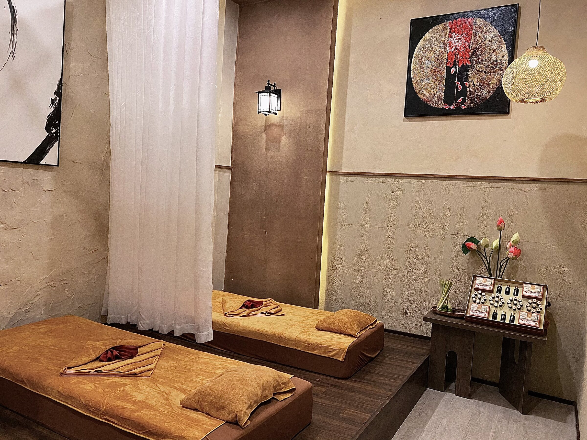

Spa treatments in Vietnam are one of the most enjoyable – and affordable – parts of a trip. But if it is your first time, small questions can make you hesitate: Do I need to book? What do I wear? Should I tip? This short guide answers the questions our international guests ask most often, so you can simply relax.

## 1. Do I need to book?

Walk-ins are often possible, but **booking ahead is best**, especially for evenings, weekends, groups or a couple room. At Mandala you can:

- Send a request through our **[online booking form](/en/contact/#dat-lich)** – we will call you back to confirm.
- **Call us** on +84 395 546 979.

Leave your phone number **with the country code** so we can reach you.

## 2. Choosing a treatment

If you are not sure, here is a quick guide:

| If you want… | Try |
|---|---|
| Something uniquely Vietnamese, in under an hour | **Herbal Head Spa** |
| To relax after travelling | **Aromatic Oil Body Massage** or **Hot Stone Body Massage** |
| Relief for a stiff neck and shoulders | **Deep Neck & Shoulder Massage** |
| A traditional herbal experience | **Royal Herbal Line** with the herbal copper roller |
| Tired legs after walking | **Herbal Foot Soak & Foot Massage** |
| Time together as a couple | **Couple room** + a package |

Still unsure? Tell us how you feel when you arrive – our therapists will recommend a treatment, free of charge.

## 3. What happens when you arrive

1. You are welcomed with **warm ginger, lemongrass and cinnamon tea**.
2. A short **consultation**: where you feel tired, your preferred pressure and any health conditions.
3. You change in a **private room**. Fresh towels and linen are used for every guest.
4. Your treatment begins. **Relax, breathe and enjoy.**
5. Afterwards, rest for a few minutes with herbal tea before you leave.

## 4. What to wear

Wear anything comfortable that is easy to change. For body massages you change in a private room, and your therapist keeps you covered with towels so only the area being treated is uncovered. For a head spa or facial, you usually keep your own clothes on. If you are unsure, just ask our reception.

## 5. Pressure and communication

Vietnamese therapists are used to welcoming international guests. If language is a barrier, **gestures work perfectly**:

- 👍 = good, keep going
- A flat hand pushing down = **stronger**
- A small wave or a gentle “soft” = **lighter**

It is always fine to ask for lighter or stronger pressure at any time.

## 6. Health – please tell us

Let your therapist know beforehand if you are **pregnant**, have **heart disease, high or unstable blood pressure, diabetes, varicose veins**, a recent injury, an open wound or a skin condition. Avoid massage on a very full or very empty stomach. Spa treatments are for relaxation and wellbeing; they do not replace medical care.

## 7. Prices and tipping

- Our prices are listed clearly in **Vietnamese dong (VND)** on our [price list](/en/price-list/) and include welcome herbal tea. There are no hidden charges.
- For payment options, simply ask our reception when you arrive.
- **Tipping is not required at Mandala.** If you are happy with your therapist, a small tip is always welcome and warmly appreciated – but it is entirely up to you.

## 8. Getting here

- 📍 **86 Han Mac Tu St., Buon Ma Thuot Ward, Dak Lak** – in the city centre
- Show your taxi or Grab driver this address in Vietnamese: **86 Hàn Mặc Tử, Phường Buôn Ma Thuột, Đắk Lắk**
- 🅿️ Car and motorbike parking available
- 🕙 Open daily **10:00 – 22:00**

Please arrive **5–10 minutes early** so you have time for tea and to change without rushing.

## 9. After your treatment

- **Drink some water** and take it easy for the rest of the evening.
- After a head spa, **wear a jacket** if it is cool outside.
- After herbal or heat treatments, wait a while before a hot shower.
- If you feel slightly sore after a deep massage, that is normal and usually fades within a day.

## Ready to relax?

Read more about our signature treatments: [Vietnamese herbal head spa](/en/blog/vietnamese-herbal-head-spa/) · [Herbal copper roller therapy](/en/blog/herbal-copper-roller-therapy/) · [Where to relax in Buon Ma Thuot](/en/blog/where-to-relax-in-buon-ma-thuot/)

[Book online](/en/contact/#dat-lich) · [See our prices](/en/price-list/)
