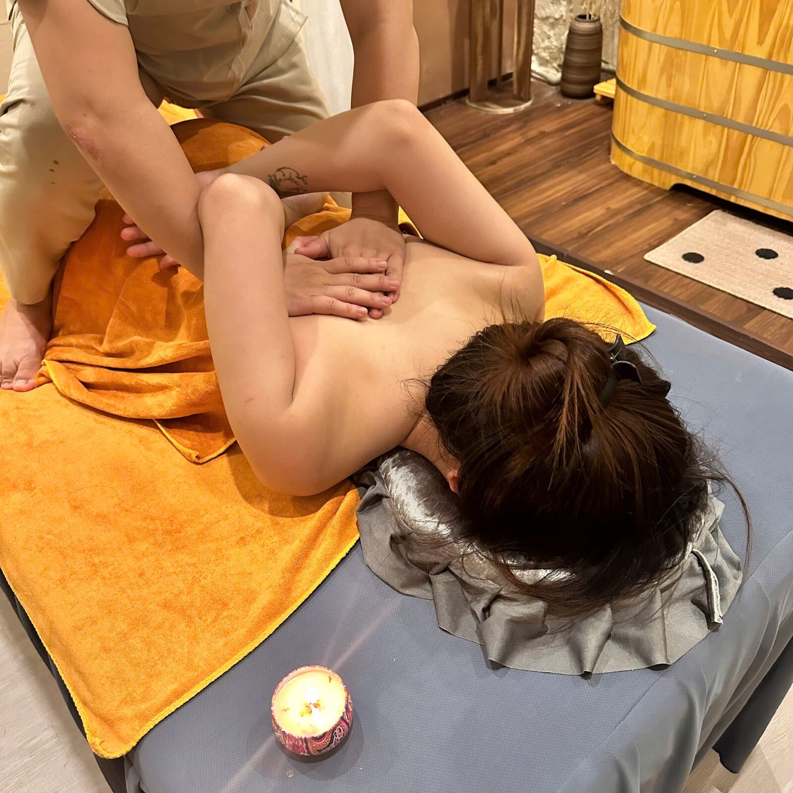

If you have seen our videos, you may have noticed a **shiny copper cylinder** rolling slowly along a guest’s back, releasing a gentle scent of herbs. This is **herbal copper roller therapy**, one of the signature treatments of our **Royal Herbal Line**. Guests often ask: what is the copper for? Is it hot? Does it hurt? Here are the answers.

## What is herbal copper roller therapy?

The therapist uses a **copper cylinder with many small holes**, filled with **warm herbs**. Holding both ends, they roll it slowly along the shoulders, back and lower back – the places where muscles tend to tighten. The treatment combines three elements:

- **Gentle heat** from the warm herbs, carried through the copper
- **The scent of herbs** escaping through the small holes
- **Rhythmic rolling pressure** that helps muscles relax

Copper **conducts heat very well**, so warmth spreads evenly over the skin instead of staying in one spot. Its smooth, round surface feels as if tight areas are being gently “ironed out”.

## Where does it come from?

The therapy is inspired by Eastern wellness methods that use **heat and herbs** to warm the body – such as warm herbal compresses and moxibustion. Instead of placing a compress in one spot, the copper roller lets heat and herbs “travel” along the body’s meridians, combined with the pressure of a massage.

## What herbs are inside?

The roller is filled with herbs that are considered **warming** in traditional Eastern medicine. The blend varies by treatment and may include:

- **Mugwort** – warming and relaxing
- **Ginger** – warm, with a strong, comforting scent
- **Cinnamon** – gently warming
- **Lemongrass** – fresh and calming
- Sea salt or other herbs that help hold the heat

Your therapist will tell you about the exact blend during your treatment.

## What does it feel like?

Most guests describe a **slowly building, deep and pleasant warmth** – like a warm compress, but with gentle pressure moving along your back. The herbal scent is calming, and many people fall asleep during the treatment.

Your therapist always **tests the temperature on their own hand** before touching your skin, starts gently and increases slowly. If it ever feels too hot, just say so – they will roll faster or switch to a cooler roller.

## Who is it for?

- People with **stiff neck, shoulders and back** from desk work, driving or long trips
- Anyone who often **feels cold** – especially in the cool, rainy highland season
- Those who prefer **warmth** over very strong pressure
- Travellers who want to try a **traditional Asian wellness therapy** that few places offer

## How it works at Mandala

1. **Welcome with warm ginger tea**
2. **Consultation** about tired or painful areas and your health history
3. **Warm-up massage** with oil
4. **Herbal copper roller** along the shoulders, back and lower back
5. **Focused work** on tight spots
6. **Warm wrap and rest** with herbal tea

## Good to combine with

- A **herbal wooden-tub soak** beforehand, so your body is already warm and relaxed
- The **dry sauna** to warm up
- A **herbal head spa** afterwards for complete head-to-toe relaxation

Read more: [Herbal foot soaks and herbal baths: benefits and how to do them](/en/blog/herbal-foot-soak/)

## Who should be careful?

Please avoid the treatment, or check with your doctor first, if you:

- Are **pregnant**
- Have **open wounds, skin conditions** or sunburn in the treatment area
- Have **diabetes** (reduced heat sensitivity can lead to burns)
- Have **heart or blood pressure problems** that are not well controlled
- Have **varicose veins** or a bleeding disorder
- Have a **fever** or feel very unwell

Your skin may look **slightly pink** afterwards because of the heat. This is normal and fades within a few hours. The therapy is for **relaxation and general wellbeing** and does not replace medical diagnosis or treatment.

## Try herbal copper roller therapy at Mandala

Copper roller therapy is part of our **Royal Herbal Line**, from **499,000 VND**:

- **Royal Herbal Neck & Shoulder Therapy** – 499,000 VND
- **Royal Herbal Deep Body Therapy** – 599,000 VND
- **Herbal Body Contouring** and **Lower-Back Warming Therapy** – 499,000 VND

Ask our reception which treatment with the copper roller suits you best.

[See the Royal Herbal Line](/en/services/oriental-wellness/) · [Book online](/en/contact/#dat-lich)
