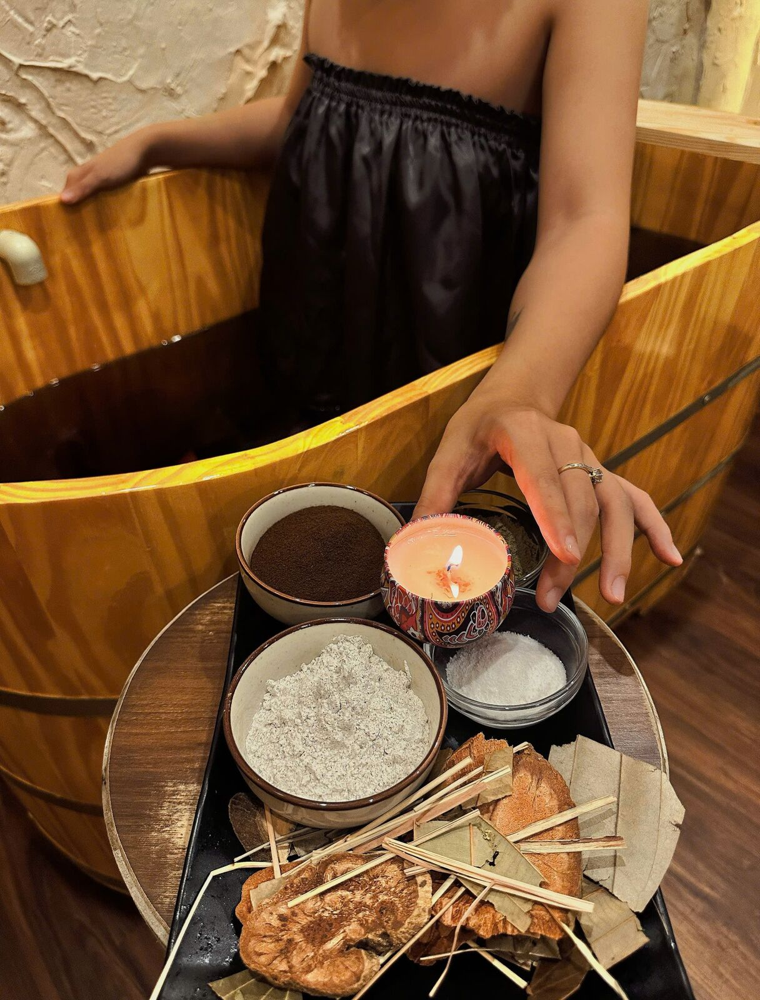
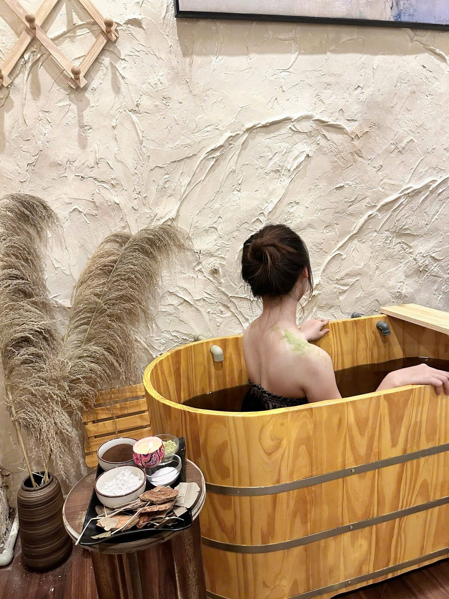
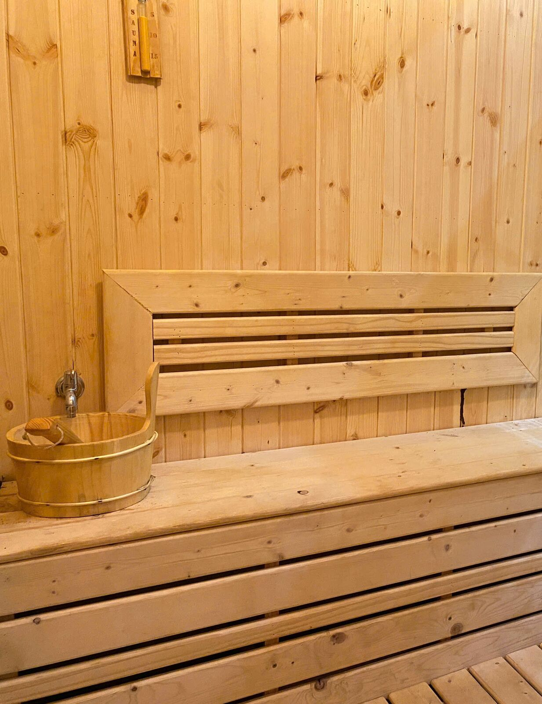

Soaking your feet in warm water with ginger, lemongrass and cinnamon is an old wellness habit across Asia – and it feels especially good in the cool highland nights of Buon Ma Thuot. A basin of fragrant warm water after a long day can help you relax and sleep better. At a spa, the ritual goes one step further with a **full-body herbal soak in a wooden tub**. Here is why herbal soaks are so loved, how to do them properly and who should be careful.

## Why soak your feet? The Eastern view

Traditional Eastern medicine sees the **feet as home to many acupressure points** and the meeting place of several meridians. An old saying goes: *“Warm feet, warm body.”* Keeping the feet warm and stimulated is believed to help **circulation** and warm the body from the ground up.

From a modern point of view, warm water widens the blood vessels in the legs, helps the muscles let go and creates a feeling of relaxation. Herbal scents such as lemongrass, ginger and cinnamon are pleasant and help calm the mind.

## Benefits people often mention

1. **Warms the body** – lovely if you often have cold hands and feet.
2. **Relaxes and relieves tiredness** after a day of standing or walking.
3. **Supports sleep** – a soak before bed helps the body wind down.
4. **Eases tired calves and feet** after walking or hiking.
5. **Calming herbal scents** that lift your mood.

*These benefits are mainly about relaxation and wellbeing; they do not replace medical treatment.*

## Common herbs

| Herb | Traditionally known for |
|---|---|
| **Ginger** | Warming |
| **Lemongrass** | Fresh, soothing scent |
| **Cinnamon** | Warming, comforting aroma |
| **Mugwort** | Warming and relaxing |
| **Pomelo leaves or peel** | Light, refreshing scent |
| **Sea salt** | Added to soothe tired feet |

At a spa, herbs are often **simmered into a concentrate** or **blended as a powder**, so the scent and warmth are richer than a simple home soak.

## Foot soak vs. full-body herbal bath

- **Foot soak:** feet and calves only, in a wooden basin, usually with **foot massage and acupressure**. Short and suitable for almost everyone.
- **Full-body wooden-tub bath:** you sit in a **large wooden tub** with warm herbal water up to your shoulders. The warmth spreads through the whole body for deep relaxation. Often combined with a massage or sauna.

## How to do a foot soak at home

1. **Comfortably warm water**, around 40–45 °C. Test with your hand or elbow – warm, never burning.
2. **Water up to the ankles** or a little higher.
3. **15–20 minutes** is enough.
4. **Best time:** in the evening, about an hour before bed.
5. **Add** a few slices of crushed ginger, some lemongrass stalks or a handful of sea salt.
6. **Dry your feet well**, especially between the toes, and wear socks if it is cold.
7. **Drink a glass of warm water** afterwards.

## Common mistakes

- **Water that is too hot** – it can scald the skin and leave you tired.
- **Soaking too long** (40–60 minutes) – it does not add benefits and can dry the skin or make you dizzy.
- **Soaking right after a big meal** or on an empty stomach.
- **Not drying between the toes**, which encourages fungus.
- **Using very strong herbal mixtures** on sensitive skin.

## Who should be careful with hot soaks?

- **People with diabetes** – reduced feeling can lead to burns without noticing.
- Anyone with **open wounds, fungal infections or skin conditions** in the area.
- People with **severe varicose veins**.
- **Pregnant women** – check with your doctor and avoid very hot water, especially full-body baths.
- People with **heart conditions or unstable blood pressure** – take extra care with hot full-body baths.
- **Straight after a big meal** – wait about an hour.
- People with **low blood pressure or dizziness** – keep it short and stand up slowly.
- When you have a **fever** or feel very tired.

## Herbal soaks at Mandala

At Mandala you can enjoy herbal soaks in two ways:

- **Herbal Foot Soak & Foot Massage** – a wooden basin with flowers and herbs, followed by foot acupressure and massage.
- **Herbal wooden-tub bath** in a private room, with a prepared herbal blend, candles, stone walls and pampas grass.

Afterwards you can add the **dry sauna** or a **massage** for a complete reset. Ask our reception which treatment with a herbal soak fits your time and needs.

Read more: [Herbal copper roller therapy](/en/blog/herbal-copper-roller-therapy/) · [Where to relax in Buon Ma Thuot](/en/blog/where-to-relax-in-buon-ma-thuot/)

[See our massage treatments](/en/services/massage-therapy/) · [Book online](/en/contact/#dat-lich)

*This article is for general information and does not replace medical advice.*
