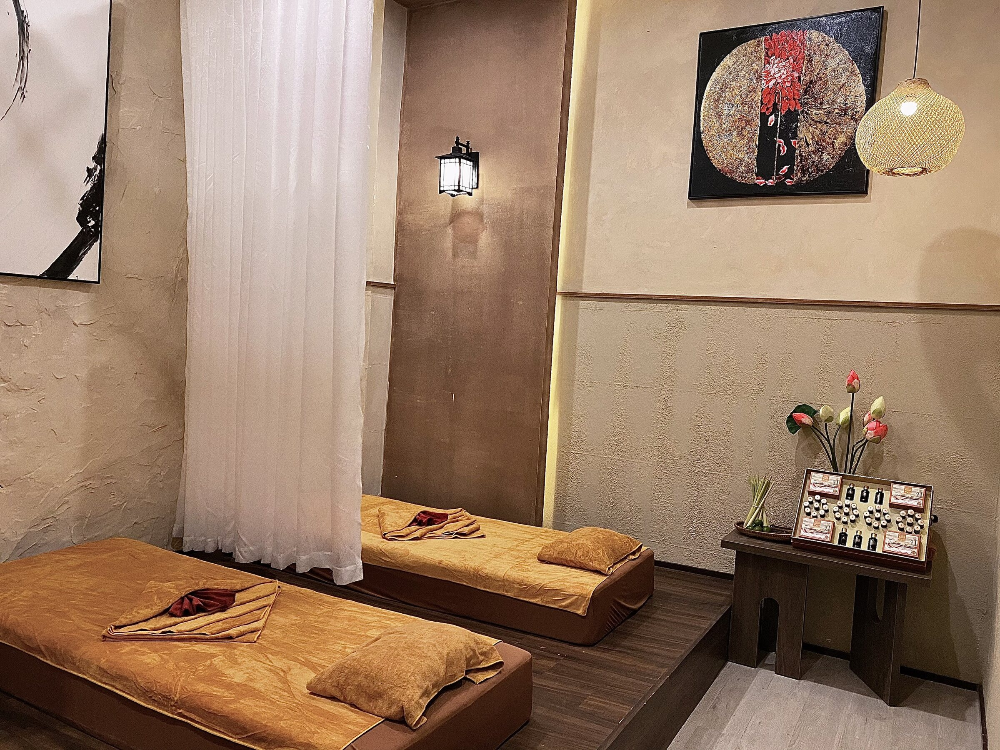

ベトナム旅行で楽しみなもののひとつが、手ごろな価格で受けられるスパ。でも初めてだと「予約は必要？」「何を着ていけばいい？」「チップは？」と、小さな疑問で迷ってしまうこともありますよね。このガイドでは、海外からのお客様によくいただくご質問にお答えします。安心して、ただくつろいでください。

## 1. 予約は必要？

予約なしでも受けられることはありますが、特に夜間、週末、グループ、カップルルームをご希望の場合は<strong>事前予約がおすすめ</strong>です。Mandalaでは：

- <strong>[オンライン予約フォーム](/ja/contact/#dat-lich)</strong>からリクエスト – 確認のお電話をいたします。
- <strong>お電話</strong>：+84 395 546 979

電話番号は<strong>国番号から</strong>ご記入ください。

## 2. メニューの選び方

迷ったら、こちらを参考にどうぞ。

| こんな方に | おすすめ |
|---|---|
| 1時間以内でベトナムらしい体験を | <strong>漢方ヘッドスパ</strong> |
| 移動の疲れをとりたい | <strong>アロマオイル全身マッサージ</strong> または <strong>ホットストーン全身マッサージ</strong> |
| 首・肩のこりをほぐしたい | <strong>首・肩ディープマッサージ</strong> |
| 伝統的な薬草ケアを体験したい | <strong>宮廷漢方シリーズ</strong>（薬草入り銅ローラー） |
| 歩き疲れた脚に | <strong>薬草足湯＆フットマッサージ</strong> |
| カップルで過ごしたい | <strong>カップルルーム</strong> ＋ コース |

それでも迷ったら、ご来店時に体の状態をお聞かせください。セラピストが無料でおすすめをご提案します。

## 3. ご来店から施術までの流れ

1. <strong>温かい生姜・レモングラス・シナモン茶</strong>でお出迎え。
2. 疲れている部位、お好みの力加減、健康状態について簡単な<strong>カウンセリング</strong>。
3. <strong>個室</strong>でお着替え。タオルやシーツはお客様ごとに交換しています。
4. 施術スタート。<strong>深呼吸して、ゆったりお楽しみください。</strong>
5. 施術後はハーブティーを飲みながら、少しお休みいただいてからお帰りください。

## 4. 服装は？

着替えやすい楽な服装でお越しください。ボディマッサージの場合は個室でお着替えいただき、施術中は施術する部分以外をタオルでおおいます。ヘッドスパやフェイシャルは、通常そのままの服装で受けられます。わからないことは受付でお気軽にお尋ねください。

## 5. 力加減の伝え方

ベトナムのセラピストは海外のお客様にも慣れています。言葉に自信がなくても、<strong>ジェスチャーで十分</strong>伝わります。

- 👍 ＝ ちょうどいい、そのままで
- 手のひらを下に押す動き ＝ <strong>もっと強く</strong>
- 小さく手を振る、または「ソフト」 ＝ <strong>もっと弱く</strong>

施術中いつでも、強さの調整をお願いして大丈夫です。

## 6. 健康について – 事前にお知らせください

<strong>妊娠中</strong>の方、<strong>心臓病、高血圧や不安定な血圧、糖尿病、静脈瘤</strong>、最近のけが、傷、皮膚疾患がある方は、施術前にセラピストにお知らせください。満腹時やひどい空腹時のマッサージは避けましょう。スパの施術はリラクゼーションと健康維持のためのもので、医療に代わるものではありません。

## 7. 料金とチップ

- 料金は[料金表](/ja/price-list/)に<strong>ベトナムドン（VND）</strong>で明記しており、ウェルカムハーブティー込み。追加料金はありません。
- お支払い方法は、ご来店時に受付でご確認ください。
- <strong>Mandalaではチップは必須ではありません。</strong> セラピストの施術にご満足いただけた場合、お気持ちでいただけるとスタッフの励みになりますが、まったくの任意です。

## 8. アクセス

- 📍 <strong>ダクラク省 バンメトート、ハンマクトゥ通り86番</strong> – 中心部
- タクシーやGrabのドライバーには、ベトナム語の住所を見せてください：<strong>86 Hàn Mặc Tử, Phường Buôn Ma Thuột, Đắk Lắk</strong>
- 🅿️ 車・バイクの駐車場あり
- 🕙 毎日 <strong>10:00〜22:00</strong> 営業

お茶やお着替えの時間をゆっくりとれるよう、<strong>5〜10分前</strong>にお越しください。

## 9. 施術のあとは

- <strong>水分補給</strong>をして、その日はゆったり過ごしましょう。
- ヘッドスパのあと、外が涼しければ<strong>上着</strong>を。
- 薬草や温熱のケアのあとは、熱いシャワーまで少し時間をあけて。
- しっかりめのマッサージのあとに少し筋肉痛のような感覚があっても、通常は1日ほどでおさまります。

## さあ、リラックスしに行きましょう

Mandalaの看板メニューについてはこちら：[ベトナムの漢方ヘッドスパ](/ja/blog/vietnamese-herbal-head-spa/) · [薬草入り銅ローラーケア](/ja/blog/herbal-copper-roller-therapy/) · [バンメトート旅行で癒されるなら](/ja/blog/where-to-relax-in-buon-ma-thuot/)

[オンライン予約](/ja/contact/#dat-lich) · [料金表を見る](/ja/price-list/)
