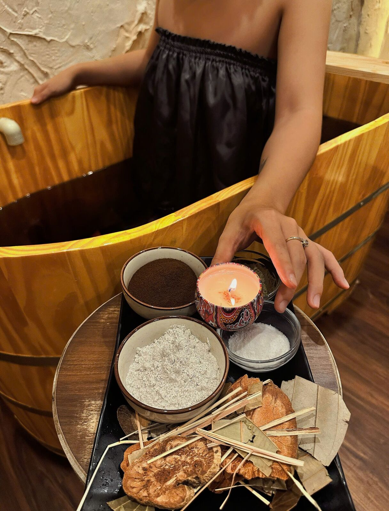
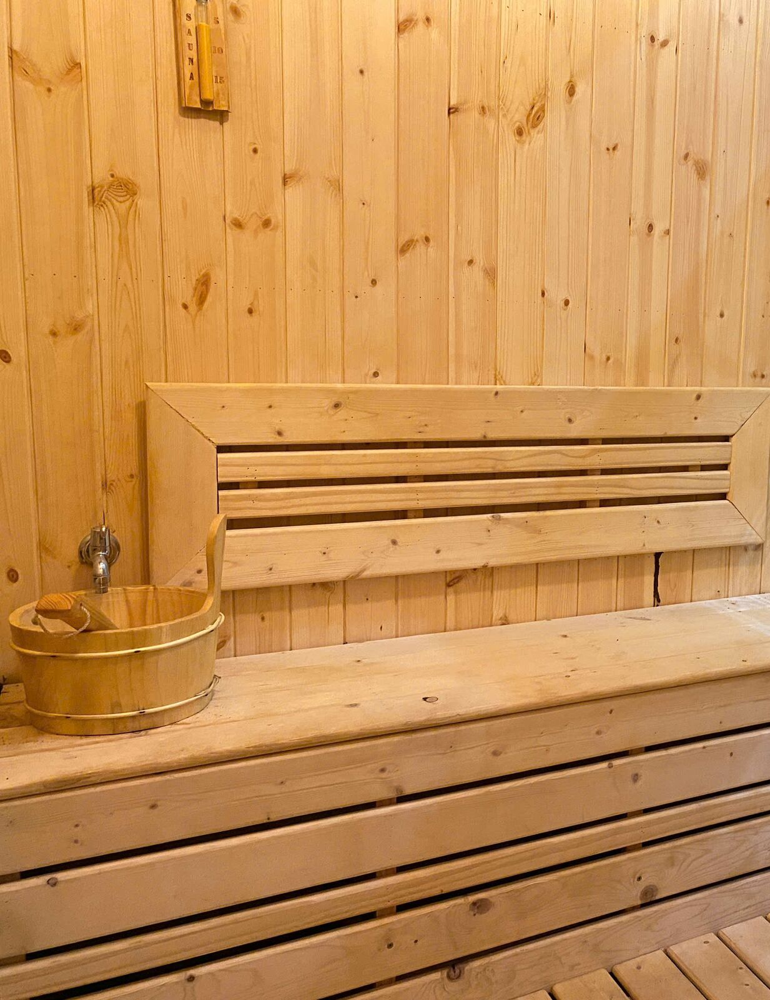

生姜やレモングラス、シナモンを入れた温かいお湯に足をひたす――アジアで古くから親しまれてきた養生の習慣です。夜が冷え込むバンメトートの高原では、なおさら心地よく感じられます。長い一日のあと、香りのよい温かい足湯は、心身をゆるめ、眠りを助けてくれます。スパではさらに一歩進んで、<strong>木桶での全身薬草浴</strong>も楽しめます。薬草浴が愛される理由、正しい入り方、注意が必要な方をご紹介します。

## 東洋医学から見た足湯

東洋医学では、<strong>足には多くのツボがあり</strong>、いくつもの経絡が通る場所と考えられています。「足が温かければ体も温かい」という言葉もあるほど。足を温め、刺激することで<strong>巡り</strong>がよくなり、体が下から温まるとされています。

現代的に見ても、温かいお湯は脚の血管を広げ、筋肉をゆるめ、リラックス感をもたらします。レモングラスや生姜、シナモンの香りは心地よく、気持ちを落ち着かせてくれます。

## よく言われる効果

1. <strong>体が温まる</strong> – 手足が冷えやすい方に特におすすめ。
2. <strong>リラックスして疲れがとれる</strong> – 立ち仕事や歩き疲れた日に。
3. <strong>眠りを助ける</strong> – 寝る前の足湯で、体が休む準備を整えます。
4. <strong>ふくらはぎや足のだるさがやわらぐ</strong> – 散策やハイキングのあとに。
5. <strong>薬草の香りで気分がやすらぐ</strong>。

*これらは主にリラックスや健康維持のためのもので、医療に代わるものではありません。*

## よく使われる薬草

| 薬草 | 昔から言われていること |
|---|---|
| <strong>生姜</strong> | 体を温める |
| <strong>レモングラス</strong> | さわやかで落ち着く香り |
| <strong>シナモン</strong> | 温かく、ほっとする香り |
| <strong>よもぎ</strong> | 温めてリラックス |
| <strong>ザボン（ブンタン）の葉や皮</strong> | 軽やかでさわやかな香り |
| <strong>粗塩</strong> | 疲れた足をいたわる |

スパでは薬草を<strong>煮出して濃縮液にしたり</strong>、<strong>パウダー状にブレンドしたり</strong>するため、自宅の足湯より香りも温かさも豊かです。

## 足湯と全身の薬草浴の違い

- <strong>足湯：</strong> 木の桶に足からふくらはぎまでをひたします。たいていは<strong>フットマッサージやツボ押し</strong>とセット。短時間で、ほとんどの方が気軽に楽しめます。
- <strong>全身の木桶浴：</strong> <strong>大きな木桶</strong>に座り、肩まで温かい薬草湯につかります。温かさが全身に広がり、深くリラックス。マッサージやサウナと組み合わせることが多いです。

## 自宅での足湯のやり方

1. <strong>心地よい温度</strong>、40〜45℃くらい。手やひじで確かめ、温かく、熱すぎないことを確認します。
2. <strong>くるぶしまで</strong>、またはもう少し上までお湯を張ります。
3. <strong>15〜20分</strong>で十分です。
4. <strong>おすすめの時間：</strong> 夜、寝る1時間前ごろ。
5. 生姜のスライス、レモングラス、ひとつかみの粗塩などを<strong>入れても</strong>。
6. 指の間まで<strong>しっかり水気をふき</strong>、寒い日は靴下を。
7. 終わったら<strong>白湯を一杯</strong>。

## よくある失敗

- <strong>お湯が熱すぎる</strong> – やけどのおそれがあり、かえって疲れます。
- <strong>長くつかりすぎる</strong>（40〜60分） – 効果は増えず、肌の乾燥やめまいの原因に。
- <strong>食後すぐ</strong>や空腹時に入る。
- <strong>指の間をふかない</strong> – 水虫の原因になります。
- 敏感肌なのに<strong>濃すぎる薬草</strong>を使う。

## 熱いお湯での足湯・入浴に注意が必要な方

- <strong>糖尿病の方</strong> – 熱さを感じにくく、気づかないうちにやけどをすることがあります。
- 足に<strong>傷、水虫、皮膚疾患</strong>がある方。
- <strong>重い静脈瘤</strong>がある方。
- <strong>妊娠中の方</strong> – 医師に相談し、特に全身浴では熱すぎるお湯は避けてください。
- <strong>心臓病や不安定な血圧</strong>の方 – 熱い全身浴は特に注意を。
- <strong>食後すぐ</strong> – 1時間ほどあけてください。
- <strong>低血圧やめまい</strong>がある方 – 短めにし、ゆっくり立ち上がりましょう。
- <strong>発熱時</strong>や、ひどく疲れているとき。

## Mandalaの薬草浴

Mandalaでは2つのスタイルで薬草浴を楽しめます。

- <strong>薬草足湯＆フットマッサージ</strong> – 花と薬草を浮かべた木の桶で足湯をしたあと、足裏のツボ押しとマッサージ。
- <strong>薬草の木桶浴</strong> – 調合済みの薬草、キャンドル、石壁とパンパスグラスに囲まれた個室で。

そのあとに<strong>ドライサウナ</strong>や<strong>マッサージ</strong>を加えれば、心も体もすっかりリセット。お時間やご希望に合う薬草浴付きのメニューは、受付でご相談ください。

あわせて読みたい：[薬草入り銅ローラーケア](/ja/blog/herbal-copper-roller-therapy/) · [バンメトート旅行で癒されるなら](/ja/blog/where-to-relax-in-buon-ma-thuot/)

[マッサージメニューを見る](/ja/services/massage-therapy/) · [オンライン予約](/ja/contact/#dat-lich)

*この記事は一般的な情報であり、医療上のアドバイスに代わるものではありません。*
