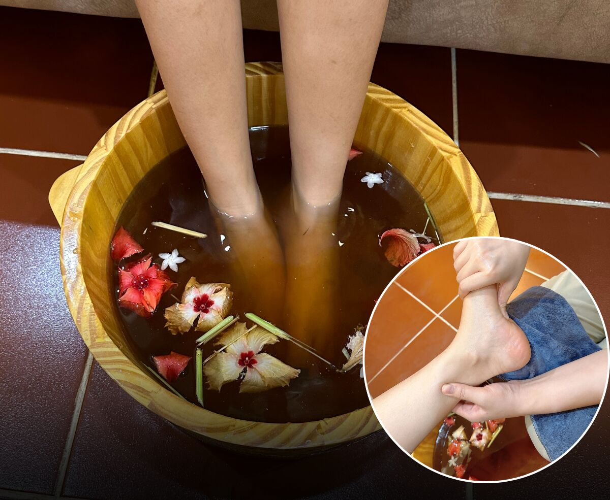

ベトナム中部高原の「コーヒーの都」バンメトート。濃厚なコーヒー、迫力ある滝、少数民族の村の文化と、旅の魅力がたくさん詰まった街です。けれども長距離バスでの移動や、滝へ続く急な階段、一日中歩き回る旅程のあとは、体にも「充電」が必要。ここでは観光と休息を上手に組み合わせ、疲れすぎずに高原の旅を満喫するコツをご紹介します。

## バンメトートで外せない体験

### ☕ コーヒー – 街の魂

まずは<strong>世界コーヒー博物館</strong>へ。コーヒーの歴史や文化を学んだら、街の庭園カフェで濃いベトナムコーヒーを一杯。バンメトート産のコーヒー豆はお土産にもぴったりです。

### 💧 ドレイヌル滝

中部高原で最も美しい滝のひとつ。黒い玄武岩の崖を白い水が勢いよく流れ落ちます。滝までの道は石段が多いので、歩きやすい靴でどうぞ。旅の中でいちばん「ふくらはぎが悲鳴をあげる」場所かもしれません。

### 🐘 ブオンドン

川にかかる揺れるつり橋、伝統的な高床式の家、高原の民族文化で知られる地域です。ブオンドンで過ごす一日は、かなり歩くことになります。

### 🛶 ラック湖

湖に沈む夕日を眺め、丸木舟に乗り、湖畔の村を訪ねてみましょう。市内からは距離があるため、夕方には腰が重く感じるかもしれません。

### 🏡 アコドン村

市内にあるエデ族の伝統的なロングハウスが並ぶ村。午後のゆったりした散策におすすめです。

*営業時間や入場料は変更になる場合があります。お出かけ前にご確認ください。*

## なぜ「癒しの夜」を予定に入れるの？

高原の旅は、<strong>長距離の移動、急な坂道、たくさんの階段</strong>の連続。さらに昼は日差しと風、夜は意外なほど冷え込みます。その結果、脚はだるく、腰は張り、リュックで肩は重く、慣れないベッドで眠りも浅くなりがち。夜のマッサージやヘッドスパ、薬草の足湯は、こんなときに役立ちます。

- 歩き疲れた<strong>ふくらはぎや足裏</strong>をほぐす
- 長時間の移動で固まった<strong>腰や肩</strong>を楽にする
- 冷える高原の夜に<strong>体を温める</strong>
- ぐっすり眠って、翌日の旅に備える

## 休息を入れた2日間のモデルプラン

<strong>1日目 – 市内観光</strong>
- 朝：世界コーヒー博物館とコーヒータイム
- 昼：ご当地グルメ
- 午後：アコドン村
- <strong>夜：Mandalaで漢方ヘッドスパ</strong> – 終わったあとはぐっすり眠れます

<strong>2日目 – 滝と村</strong>
- 朝：ドレイヌル滝
- 午後：ブオンドンまたはラック湖
- <strong>夜：ホットストーンマッサージ、または薬草足湯＆フットマッサージ</strong>で一日がんばった脚をいたわって

さらに滞在が長ければ、<strong>薬草の木桶浴とドライサウナ</strong>の夜も。アジアの養生文化をたっぷり味わえます。

## こんな日にはこのメニュー

| こんな日のあとに | おすすめ | 料金 |
|---|---|---|
| 一日中歩いた、滝の階段を上り下りした | <strong>薬草足湯＆フットマッサージ</strong> ＋ 漢方ヘッドスパ | 料金はお問い合わせください |
| 長時間バスや車に乗った | <strong>ホットストーン全身マッサージ</strong> | 349,000 VND |
| アジアらしい体験をしたい | <strong>宮廷漢方シリーズ（薬草入り銅ローラー）</strong> | 499,000 VND〜 |
| カップル・家族旅行 | <strong>カップルルーム</strong> ＋ コース | 799,000 VND〜 |
| 空き時間が1時間だけ | <strong>漢方ヘッドスパ</strong> | 159,000 VND |

## Mandala – 街の中心のくつろぎスポット

- 📍 <strong>バンメトート、ハンマクトゥ通り86番</strong> – 中心部にあり、多くのホテルから行きやすい立地
- 🕙 <strong>毎日10:00〜22:00営業</strong> – 観光のあとでも間に合います
- 🌏 ヨーロッパ、日本、韓国など<strong>海外からのお客様</strong>も多くいらっしゃいます
- 🍵 お出迎えは温かい生姜・レモングラス・シナモン茶。冷える夜にぴったり
- 🅿️ 車・バイクの駐車場あり
- ☎ <strong>+84 395 546 979</strong>

## 旅行者のためのちょっとしたコツ

1. グループの方やカップルルームをご希望の方は、<strong>前日までのご予約</strong>がおすすめです。
2. 日中は観光に使えるよう、<strong>18時以降の時間帯</strong>を選ぶのがおすすめ。
3. 高原の夜は冷えます。特にヘッドスパのあとは<strong>薄手の上着</strong>があると安心です。
4. 高原の空気は乾燥しているので、<strong>こまめに水分補給</strong>を。
5. コーヒーは朝に楽しんで、ぐっすり眠りたい日は<strong>夜は控えめに</strong>。
6. ドライバーにはベトナム語の住所を見せましょう：<strong>86 Hàn Mặc Tử, Phường Buôn Ma Thuột, Đắk Lắk</strong>

ベトナムのスパは初めて？ [はじめてのベトナムスパ：知っておきたいこと](/ja/blog/first-time-at-a-spa-in-vietnam/)もどうぞ。

[オンライン予約](/ja/contact/#dat-lich) · [料金表を見る](/ja/price-list/)
