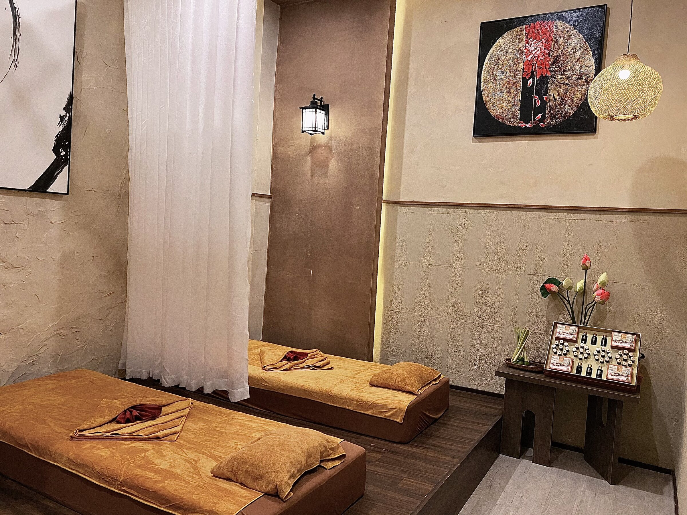

베트남 여행의 즐거움 중 하나는 합리적인 가격으로 받을 수 있는 스파입니다. 하지만 처음이라면 "예약해야 하나?", "뭘 입고 가지?", "팁은 줘야 하나?" 같은 작은 고민이 생기기 마련이지요. 해외 고객들이 자주 묻는 질문을 모아 정리했습니다. 마음 편히 쉬기만 하세요.

## 1. 예약해야 하나요?

예약 없이 방문해도 가능한 경우가 있지만, 저녁 시간, 주말, 단체, 커플룸을 원하신다면 <strong>미리 예약하시는 것이 가장 좋습니다</strong>. Mandala에서는:

- <strong>[온라인 예약 양식](/ko/contact/#dat-lich)</strong>으로 요청 – 확인 전화를 드립니다.
- <strong>전화</strong>: +84 395 546 979

전화번호는 <strong>국가번호를 포함해</strong> 남겨 주세요.

## 2. 관리 고르기

고민되신다면 아래를 참고해 보세요.

| 이런 분께 | 추천 |
|---|---|
| 1시간 안에 베트남다운 체험을 | <strong>한방 헤드스파</strong> |
| 이동의 피로를 풀고 싶다 | <strong>아로마 오일 전신 마사지</strong> 또는 <strong>핫스톤 전신 마사지</strong> |
| 목·어깨 결림을 풀고 싶다 | <strong>목·어깨 집중 마사지</strong> |
| 전통 약초 관리를 체험하고 싶다 | <strong>궁중 한방 라인</strong> (약초 구리 롤러) |
| 많이 걸어 지친 다리 | <strong>약초 족욕 & 발 마사지</strong> |
| 커플이 함께 | <strong>커플룸</strong> + 코스 |

그래도 고민되시면 방문하셔서 몸 상태를 말씀해 주세요. 테라피스트가 무료로 추천해 드립니다.

## 3. 도착부터 관리까지

1. <strong>따뜻한 생강·레몬그라스·계피 차</strong>로 맞이합니다.
2. 피로한 부위, 원하시는 압, 건강 상태에 대한 간단한 <strong>상담</strong>.
3. <strong>개인실</strong>에서 환복합니다. 수건과 시트는 고객마다 새로 교체합니다.
4. 관리를 시작합니다. <strong>천천히 호흡하며 즐기세요.</strong>
5. 관리 후 허브차와 함께 잠시 쉬었다 가세요.

## 4. 무엇을 입고 가나요?

갈아입기 편한 옷이면 충분합니다. 전신 마사지는 개인실에서 환복하며, 관리 중에는 관리하는 부위 외에는 수건으로 덮어 드립니다. 헤드스파나 페이셜은 보통 입고 오신 옷 그대로 받으실 수 있습니다. 궁금한 점은 리셉션에 편하게 물어보세요.

## 5. 압 조절 요청하기

베트남 테라피스트들은 해외 고객 응대에 익숙합니다. 말이 잘 통하지 않아도 <strong>손짓으로 충분히</strong> 전달됩니다.

- 👍 = 좋아요, 이대로
- 손바닥으로 아래를 누르는 동작 = <strong>더 세게</strong>
- 손을 살짝 흔들거나 "소프트" = <strong>더 약하게</strong>

관리 중 언제든지 압 조절을 요청하셔도 괜찮습니다.

## 6. 건강 – 미리 알려 주세요

<strong>임신 중</strong>이시거나 <strong>심장 질환, 고혈압이나 불안정한 혈압, 당뇨, 하지정맥류</strong>, 최근 부상, 상처, 피부 질환이 있으시면 관리 전에 테라피스트에게 알려 주세요. 너무 배부르거나 배고플 때의 마사지는 피하세요. 스파 관리는 휴식과 건강 관리를 위한 것이며 의학적 치료를 대신하지 않습니다.

## 7. 가격과 팁

- 가격은 [가격표](/ko/price-list/)에 <strong>베트남 동(VND)</strong>으로 명확히 안내되어 있으며, 웰컴 허브차가 포함되어 있습니다. 추가 요금은 없습니다.
- 결제 방법은 방문 시 리셉션에 문의해 주세요.
- <strong>Mandala에서는 팁이 필수가 아닙니다.</strong> 테라피스트의 관리가 만족스러우셨다면 마음을 담아 주시는 팁은 언제나 감사히 받지만, 전적으로 고객님의 선택입니다.

## 8. 찾아오는 길

- 📍 <strong>닥락성 부온마투옷, 한막뜨 거리 86번지</strong> – 시내 중심
- 택시나 그랩(Grab) 기사님께 베트남어 주소를 보여 주세요: <strong>86 Hàn Mặc Tử, Phường Buôn Ma Thuột, Đắk Lắk</strong>
- 🅿️ 자동차·오토바이 주차 가능
- 🕙 매일 <strong>10:00 – 22:00</strong> 영업

차를 마시고 여유 있게 환복하실 수 있도록 <strong>5~10분 일찍</strong> 와 주세요.

## 9. 관리 후에는

- <strong>물을 충분히</strong> 마시고 그날 저녁은 여유롭게 보내세요.
- 헤드스파 후 바깥이 쌀쌀하면 <strong>겉옷</strong>을 입으세요.
- 약초나 온열 관리 후에는 뜨거운 샤워까지 잠시 시간을 두세요.
- 강한 마사지 후 근육이 살짝 뻐근할 수 있지만, 보통 하루 정도면 괜찮아집니다.

## 이제 쉬러 가 볼까요?

Mandala의 시그니처 관리가 궁금하다면: [베트남 한방 헤드스파](/ko/blog/vietnamese-herbal-head-spa/) · [약초 구리 롤러 테라피](/ko/blog/herbal-copper-roller-therapy/) · [부온마투옷 여행, 어디서 쉬어 갈까?](/ko/blog/where-to-relax-in-buon-ma-thuot/)

[온라인 예약](/ko/contact/#dat-lich) · [가격표 보기](/ko/price-list/)
