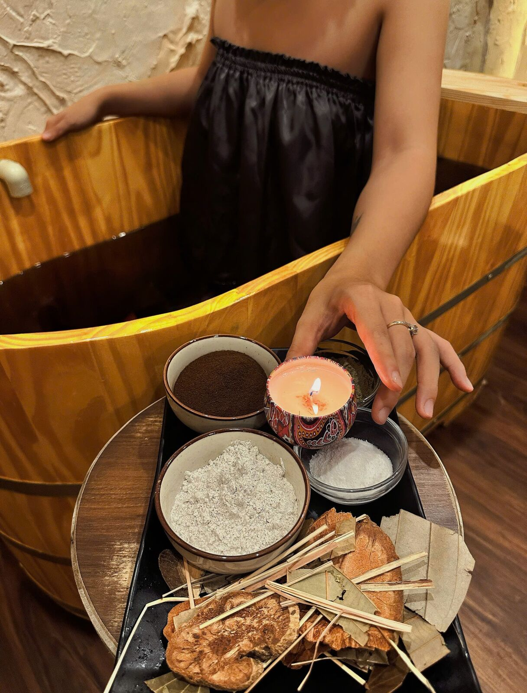
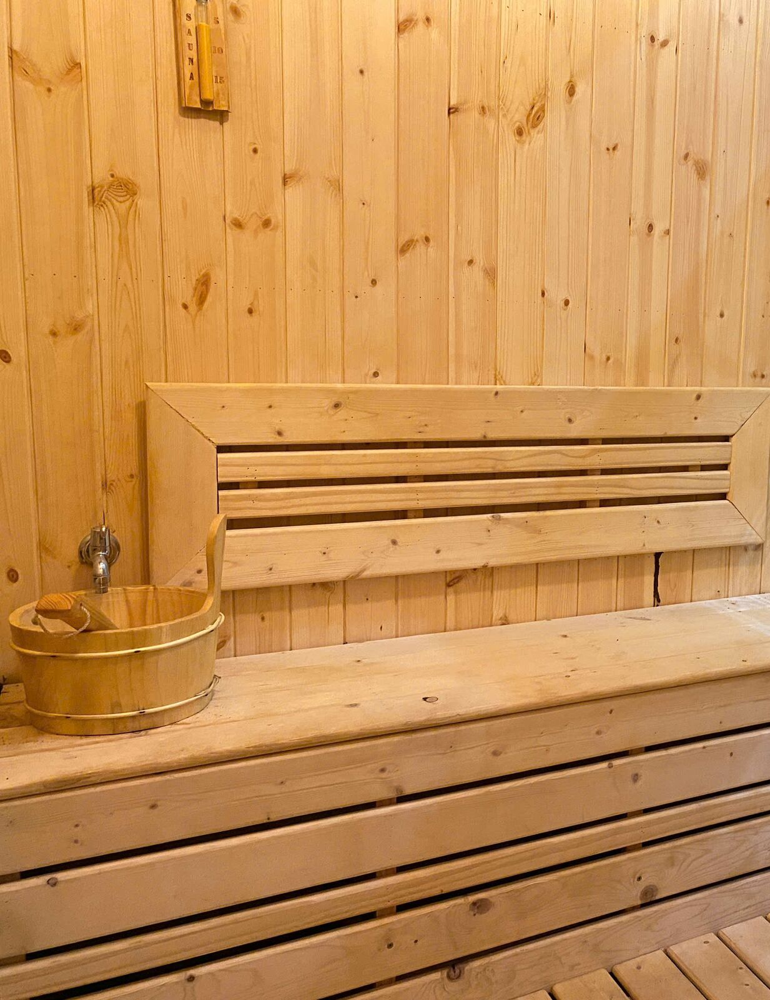

생강, 레몬그라스, 계피를 넣은 따뜻한 물에 발을 담그는 것은 아시아에서 오래전부터 이어져 온 양생 습관입니다. 밤이 쌀쌀한 부온마투옷 고원에서는 더욱 기분 좋게 느껴지지요. 긴 하루를 보낸 뒤 향긋한 족욕 한 번이면 몸과 마음이 풀리고 잠도 잘 옵니다. 스파에서는 한 걸음 더 나아가 <strong>나무 욕조에서의 전신 약초 입욕</strong>도 즐길 수 있습니다. 약초 입욕이 사랑받는 이유, 올바른 방법, 주의가 필요한 분을 알아봅니다.

## 한의학으로 본 족욕

한의학에서는 <strong>발에 많은 혈자리가 있고</strong> 여러 경락이 지나가는 곳으로 봅니다. "발이 따뜻하면 몸이 따뜻하다"는 말도 있지요. 발을 따뜻하게 하고 자극하면 <strong>순환</strong>이 좋아져 몸이 아래부터 데워진다고 여겨집니다.

현대적으로 보아도 따뜻한 물은 다리의 혈관을 넓히고 근육을 풀어 편안함을 줍니다. 레몬그라스, 생강, 계피 향은 기분을 좋게 하고 마음을 차분하게 해 줍니다.

## 흔히 말하는 효과

1. <strong>몸을 따뜻하게</strong> – 손발이 자주 차가운 분께 특히 좋습니다.
2. <strong>긴장을 풀고 피로 회복</strong> – 오래 서 있거나 많이 걸은 날에.
3. <strong>숙면에 도움</strong> – 자기 전 족욕이 몸을 쉴 준비 상태로 만들어 줍니다.
4. <strong>종아리와 발의 피로 완화</strong> – 산책이나 하이킹 후에.
5. <strong>약초 향으로 기분 전환</strong>.

*이러한 효과는 주로 휴식과 건강 관리를 위한 것이며 의학적 치료를 대신하지 않습니다.*

## 자주 쓰는 약초

| 약초 | 전통적으로 알려진 특징 |
|---|---|
| <strong>생강</strong> | 몸을 따뜻하게 함 |
| <strong>레몬그라스</strong> | 상쾌하고 편안한 향 |
| <strong>계피</strong> | 따뜻하고 포근한 향 |
| <strong>쑥</strong> | 따뜻하게 하고 이완 |
| <strong>자몽(포멜로) 잎이나 껍질</strong> | 가볍고 상쾌한 향 |
| <strong>굵은 소금</strong> | 지친 발을 달래 줌 |

스파에서는 약초를 <strong>진하게 달이거나</strong> <strong>가루로 배합</strong>하기 때문에, 집에서 하는 족욕보다 향과 온기가 훨씬 풍부합니다.

## 족욕과 전신 약초 입욕의 차이

- <strong>족욕:</strong> 나무통에 발부터 종아리까지 담급니다. 보통 <strong>발 마사지와 지압</strong>이 함께합니다. 짧고 대부분의 분이 부담 없이 즐길 수 있습니다.
- <strong>전신 나무 욕조 입욕:</strong> <strong>큰 나무 욕조</strong>에 앉아 어깨까지 따뜻한 약초 물에 몸을 담급니다. 온기가 온몸으로 퍼져 깊이 이완됩니다. 마사지나 사우나와 함께하는 경우가 많습니다.

## 집에서 족욕하는 방법

1. <strong>기분 좋게 따뜻한 물</strong>, 약 40~45℃. 손이나 팔꿈치로 확인해 따뜻하되 뜨겁지 않게 합니다.
2. <strong>복사뼈까지</strong> 또는 조금 더 위까지 물을 채웁니다.
3. <strong>15~20분</strong>이면 충분합니다.
4. <strong>추천 시간:</strong> 저녁, 잠들기 약 1시간 전.
5. 생강 몇 조각, 레몬그라스, 굵은 소금 한 줌 등을 <strong>넣어도</strong> 좋습니다.
6. 발가락 사이까지 <strong>물기를 잘 닦고</strong>, 추우면 양말을 신으세요.
7. 끝난 후 <strong>따뜻한 물 한 잔</strong>을 마십니다.

## 흔한 실수

- <strong>물이 너무 뜨거움</strong> – 화상 위험이 있고 오히려 피곤해집니다.
- <strong>너무 오래 담금</strong> (40~60분) – 효과가 더해지지 않고 피부 건조나 어지러움의 원인이 됩니다.
- <strong>식사 직후</strong>나 공복에 하기.
- <strong>발가락 사이를 닦지 않음</strong> – 무좀의 원인이 됩니다.
- 민감한 피부에 <strong>너무 진한 약초</strong> 사용.

## 뜨거운 족욕·입욕 시 주의가 필요한 분

- <strong>당뇨병이 있는 분</strong> – 감각이 둔해 모르는 사이 화상을 입을 수 있습니다.
- 담그는 부위에 <strong>상처, 무좀, 피부 질환</strong>이 있는 분.
- <strong>심한 하지정맥류</strong>가 있는 분.
- <strong>임신 중인 분</strong> – 의사와 상의하고, 특히 전신 입욕에서는 너무 뜨거운 물을 피하세요.
- <strong>심장 질환이나 불안정한 혈압</strong>이 있는 분 – 뜨거운 전신 입욕은 특히 주의하세요.
- <strong>식사 직후</strong> – 1시간 정도 지난 뒤에.
- <strong>저혈압이나 어지럼증</strong>이 있는 분 – 짧게 하고 천천히 일어나세요.
- <strong>열이 나거나</strong> 몹시 피곤할 때.

## Mandala의 약초 입욕

Mandala에서는 두 가지 방식으로 약초 입욕을 즐길 수 있습니다.

- <strong>약초 족욕 & 발 마사지</strong> – 꽃과 약초를 띄운 나무통에서 족욕 후 발바닥 지압과 마사지.
- <strong>약초 나무 욕조 입욕</strong> – 미리 배합한 약초, 캔들, 돌벽과 팜파스 그라스가 있는 개인실에서.

이후 <strong>건식 사우나</strong>나 <strong>마사지</strong>를 더하면 몸과 마음이 완전히 리셋됩니다. 일정과 원하시는 바에 맞는 약초 입욕 포함 관리는 리셉션에 문의해 주세요.

함께 읽기: [약초 구리 롤러 테라피](/ko/blog/herbal-copper-roller-therapy/) · [부온마투옷 여행, 어디서 쉬어 갈까?](/ko/blog/where-to-relax-in-buon-ma-thuot/)

[마사지 메뉴 보기](/ko/services/massage-therapy/) · [온라인 예약](/ko/contact/#dat-lich)

*이 글은 일반적인 정보이며 의학적 조언을 대신하지 않습니다.*
