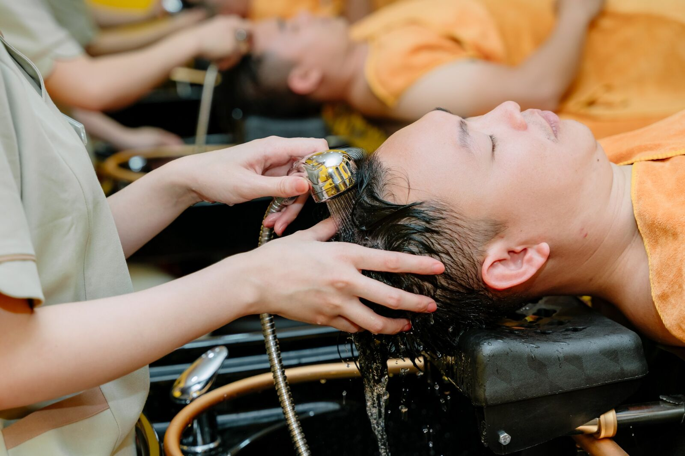
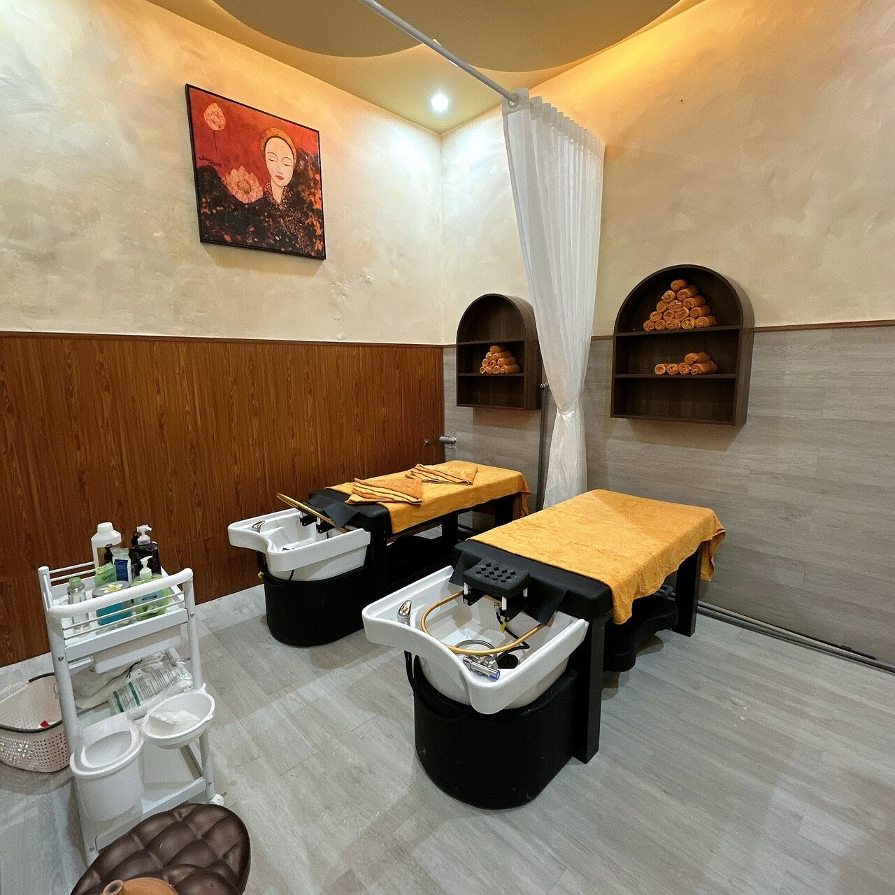

베트남을 여행하다 보면 뒤로 젖혀진 침대에 누워 눈을 감은 채, 테라피스트에게 천천히 머리를 감고 마사지 받는 사람들을 볼 수 있습니다. 이것이 바로 <strong>고이자우 즈엉신(gội đầu dưỡng sinh)</strong>, 베트남 한방 헤드스파입니다. 한 시간도 안 되는 시간에 "머리가 리셋된 것 같다"고 말하는 분이 많아, 베트남에서 가장 사랑받는 휴식법 중 하나가 되었습니다.

## 한방 헤드스파란?

한방 헤드스파는 동양 전통 의학의 원리에 바탕을 둔 두피·머리 관리입니다. 한의학에서는 머리를 많은 경락과 중요한 혈자리가 모이는 곳으로 봅니다. 이 부위를 부드럽고 올바르게 자극하면 순환이 좋아지고, 몸은 이완되며, 머리는 맑아집니다.

머리를 깨끗하게 하는 것이 목적인 일반 샴푸와 달리, 한방 헤드스파는 <strong>여러 단계로 이루어진 케어 의식</strong>입니다. 약초 물로 머리 감기, 두피 지압, 얼굴·목·어깨 마사지, 그리고 마지막으로 따뜻한 타월로 감싸 줍니다.

## 고객들이 좋아하는 5가지 이유

<strong>1. 스트레스와 긴장성 두통 완화.</strong> 관자놀이, 정수리, 뒷목을 천천히 리드미컬하게 눌러 주면 머리와 목의 근육이 풀립니다.

<strong>2. 더 깊은 잠.</strong> "헤드스파 받은 날 밤에 정말 잘 잤다"는 이야기를 자주 듣습니다. 따뜻한 물, 약초 향, 조용한 공간이 몸을 휴식 모드로 바꿔 줍니다.

<strong>3. 가벼워지는 목과 어깨.</strong> 함께 진행하는 목·어깨 마사지는 오래 컴퓨터를 보거나 장거리 이동을 한 분들께 특히 좋습니다.

<strong>4. 두피와 모발 케어.</strong> 무환자(보켓), 레몬그라스, 생강 같은 전통 약초가 부드럽게 세정해 두피는 개운하고 머릿결은 자연스럽게 부드러워집니다.

<strong>5. 마음을 위한 고요한 시간.</strong> 휴대폰과 여행 일정에서 잠시 벗어나 호흡과 편안함만 느끼는 시간입니다.

## 단계별 관리 과정

1. <strong>따뜻한 생강차로 맞이</strong>하며 몸을 편안하게 합니다.
2. 두통, 수면, 두피 고민에 대해 <strong>간단히 상담</strong>하고 관리를 조절합니다.
3. 목·어깨를 <strong>풀어 주는 마사지</strong>.
4. 따뜻한 약초 물로 <strong>머리와 두피 세정</strong>.
5. 관자놀이, 정수리, 뒷머리 헤어라인 <strong>지압</strong>.
6. <strong>얼굴 마사지와 따뜻한 타월</strong>로 완벽한 휴식.
7. <strong>드라이 후 허브차와 함께 휴식</strong>.

*릴랙스 샴푸, 한방 헤드스파, 중국식 헤드스파에 따라 과정이 조금씩 다릅니다.*

## 일반 샴푸와 무엇이 다를까?

| | 일반 샴푸 | 한방 헤드스파 |
|---|---|---|
| 목적 | 머리 감기 | 머리·목·마음의 이완 |
| 사용하는 것 | 샴푸 | 따뜻한 약초 물, 순한 제품 |
| 마사지 | 거의 없음 | 지압, 얼굴·목·어깨 마사지 |
| 받고 난 후 | 깔끔함 | 깔끔함, 가벼운 머리, 깊은 휴식 |

## 이런 분께 추천합니다

- 긴 여행과 늦은 밤으로 지친 여행자
- 머리를 많이 쓰는 일로 스트레스를 받기 쉬운 분
- 가벼운 긴장성 두통이나 불면이 신경 쓰이는 분
- 컴퓨터·스마트폰으로 목과 어깨가 자주 뭉치는 분
- 베트남에서 부담 없이 체험할 수 있는 부드러운 관리를 찾는 분

<strong>유의 사항:</strong> 머리에 상처가 있거나 두피 질환, 불안정한 혈압이 있으신 분, 임신 중이신 분은 미리 테라피스트에게 알려 주세요. 헤드스파는 휴식을 위한 관리이며 의학적 치료를 대신하지 않습니다.

## 첫 헤드스파를 더 즐기는 팁

- 앞뒤 <strong>일정을 여유 있게</strong> 잡으세요. 끝나자마자 서두르면 여운이 아깝습니다.
- <strong>원하는 압을 편하게</strong> 말씀해 주세요. 손짓만으로도 충분합니다.
- 저녁에 받으신다면 <strong>얇은 겉옷</strong>을 챙기세요. 고원의 밤은 쌀쌀하고 모발 뿌리가 살짝 촉촉할 수 있어요.
- 헤어 스타일링은 <strong>다음 날 아침에</strong>. 두피도 쉬게 해 주세요.

## 얼마나 자주 받으면 좋을까?

편안한 상태를 유지하려면 주 1~2회가 이상적이며, 피곤하거나 스트레스를 느낄 때 받으셔도 좋습니다. 여행 중에는 도착한 날과 떠나기 전, 두 번 찾아 주시는 분도 있습니다.

## 부온마투옷 Mandala에서 한방 헤드스파를

Mandala에서는 <strong>릴랙스 샴푸(69,000 VND)</strong>, <strong>한방 헤드스파(159,000 VND)</strong>, <strong>중국식 헤드스파(239,000 VND)</strong>, <strong>두피·목·어깨 집중 케어(399,000 VND)</strong> 중에서 원하는 관리와 시간에 맞춰 선택하실 수 있습니다.

[헤드스파 메뉴 보기](/ko/services/head-spa/) · [온라인 예약](/ko/contact/#dat-lich)
