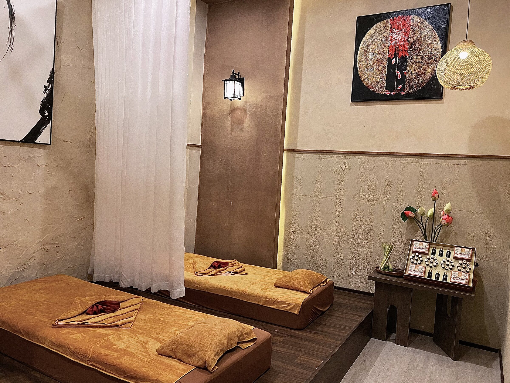
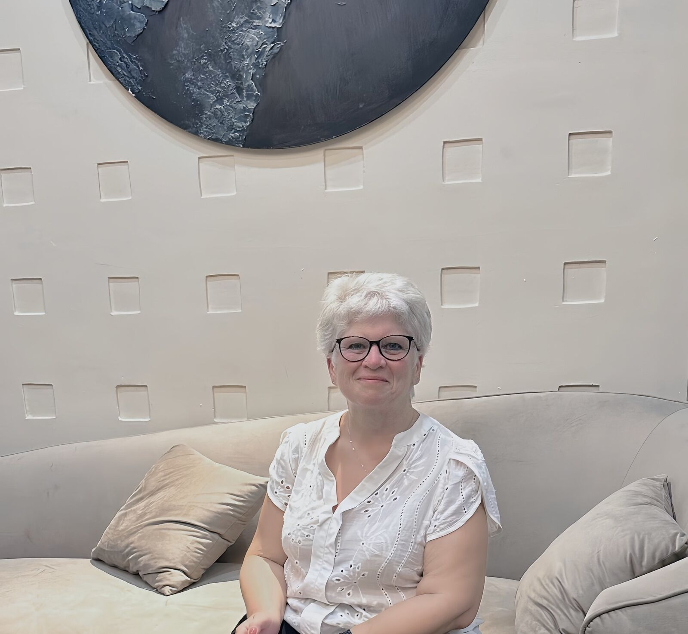

在越南旅行，以实惠的价格享受水疗是一大乐趣。不过第一次去，难免会有些小疑问：要预约吗？穿什么？要不要给小费？这篇指南整理了国际顾客最常问的问题，让您只管放松就好。

## 1. 需要预约吗？

有时不预约也可以，但如果是晚上、周末、多人同行或想要双人房，<strong>最好提前预约</strong>。在 Mandala，您可以：

- 通过<strong>[在线预约表单](/zh/contact/#dat-lich)</strong>提交——我们会致电与您确认。
- <strong>致电</strong>：+84 395 546 979

请留下<strong>含国际区号</strong>的电话号码，方便我们联系您。

## 2. 怎么选项目？

拿不定主意时，可以参考：

| 如果您想要… | 推荐 |
|---|---|
| 一小时内体验越南特色 | <strong>草本养生洗头</strong> |
| 缓解旅途疲劳 | <strong>精油全身按摩</strong>或<strong>热石全身按摩</strong> |
| 放松僵硬的肩颈 | <strong>肩颈深层按摩</strong> |
| 体验传统草本护理 | <strong>宫廷御医系列</strong>（草本铜管热滚） |
| 走累了的双腿 | <strong>草本泡脚 · 足部按摩</strong> |
| 两人一起放松 | <strong>双人房</strong> + 套餐 |

还是不确定？到店时告诉我们您的身体状况，技师会免费为您推荐。

## 3. 到店后的流程

1. 以<strong>温热的姜、香茅、肉桂茶</strong>迎接您。
2. 简短<strong>咨询</strong>：哪里疲劳、喜欢的力度和健康状况。
3. 在<strong>独立房间</strong>更衣。毛巾、床单每位顾客都会更换。
4. 理疗开始，<strong>深呼吸，尽情享受。</strong>
5. 结束后品一杯草本茶，稍作休息再离开。

## 4. 穿什么？

穿方便更换的舒适衣服即可。身体按摩会在独立房间更衣，理疗时除正在护理的部位外，技师会用毛巾为您遮盖。头疗或面部护理通常穿自己的衣服即可。有疑问请随时问前台。

## 5. 怎么表达力度？

越南的技师很熟悉接待外国顾客。即使语言不通，<strong>用手势就足够</strong>：

- 👍 = 刚好，继续
- 手掌向下按的动作 = <strong>重一点</strong>
- 轻轻摆手，或说“soft” = <strong>轻一点</strong>

理疗过程中随时都可以要求调整力度。

## 6. 健康状况——请提前告知

如您<strong>怀孕</strong>，或有<strong>心血管疾病、高血压或血压不稳、糖尿病、静脉曲张</strong>、近期受伤、开放性伤口或皮肤病，请在理疗前告知技师。避免在过饱或过饿时按摩。水疗以放松和保健为目的，不能替代医疗。

## 7. 价格与小费

- 价格以<strong>越南盾（VND）</strong>清楚列在[价目表](/zh/price-list/)上，含迎宾草本茶，无任何额外费用。
- 付款方式请到店时向前台咨询。
- <strong>Mandala 不强制收取小费。</strong> 如果您对技师的服务满意，随心给予的小费我们都会心怀感谢，但完全由您决定。

## 8. 如何到达

- 📍 <strong>多乐省邦美蜀坊 Han Mac Tu 街 86 号</strong>——位于市中心
- 请把越南语地址给出租车或 Grab 司机看：<strong>86 Hàn Mặc Tử, Phường Buôn Ma Thuột, Đắk Lắk</strong>
- 🅿️ 提供汽车及摩托车停车位
- 🕙 每天 <strong>10:00 – 22:00</strong> 营业

建议<strong>提前 5–10 分钟</strong>到店，从容地喝茶、更衣。

## 9. 理疗之后

- <strong>多喝水</strong>，当晚放慢节奏好好休息。
- 头疗后如果外面较凉，记得穿上<strong>外套</strong>。
- 草本或热疗项目后，稍等一会儿再洗热水澡。
- 深层按摩后肌肉略有酸痛属正常，通常一天左右就会消失。

## 准备好放松了吗？

了解更多招牌项目：[越南草本养生洗头](/zh/blog/vietnamese-herbal-head-spa/) · [草本铜管热滚疗法](/zh/blog/herbal-copper-roller-therapy/) · [邦美蜀旅行去哪里放松](/zh/blog/where-to-relax-in-buon-ma-thuot/)

[在线预约](/zh/contact/#dat-lich) · [查看价目表](/zh/price-list/)
