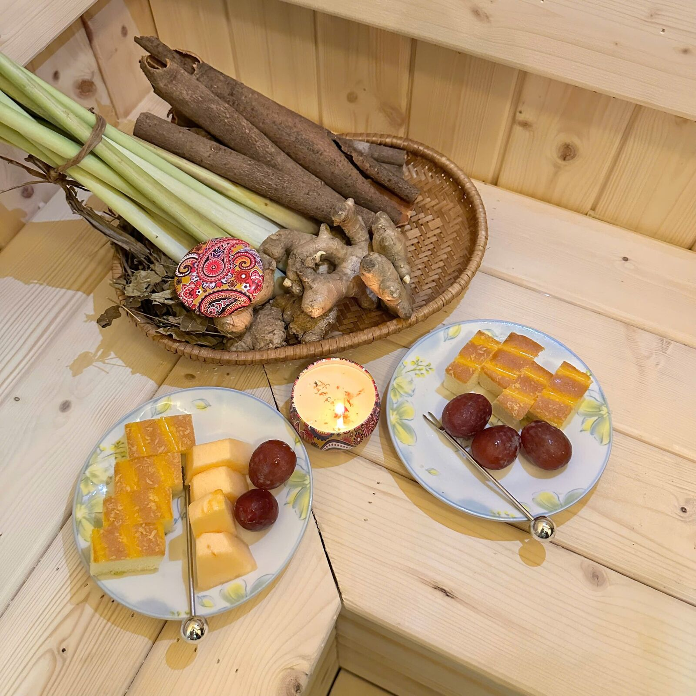
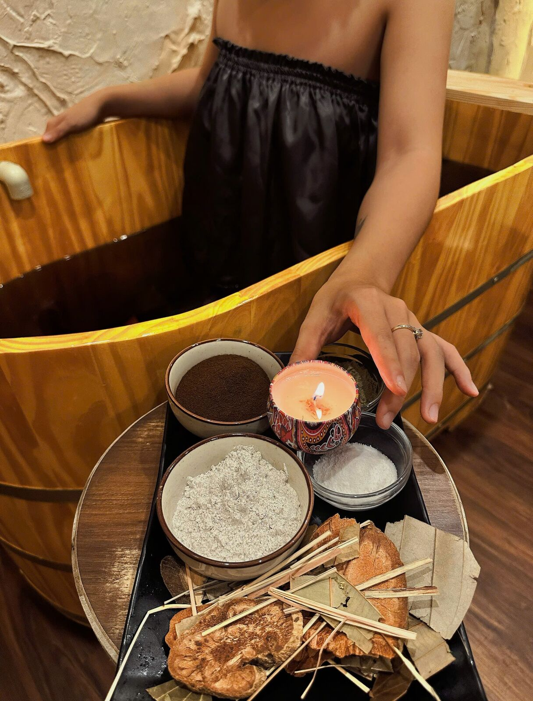
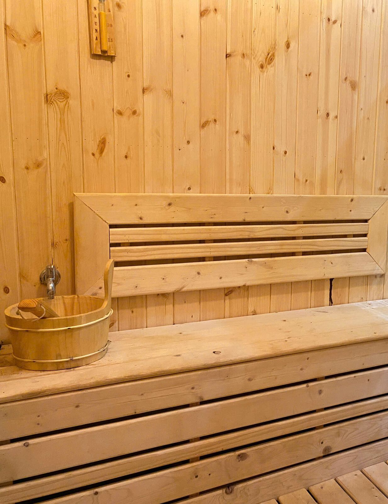

用加了生姜、香茅、肉桂的温水泡脚，是亚洲流传已久的养生习惯；在夜晚微凉的邦美蜀高原，更是格外舒服。忙碌一天后，一盆香气四溢的热水就能让人放松下来、睡得更好。在水疗馆，这一仪式还能升级为<strong>木桶全身草本浴</strong>。下面介绍草本浴受欢迎的原因、正确的方法，以及哪些人需要注意。

## 从中医角度看泡脚

中医认为<strong>脚部有许多穴位</strong>，是多条经络经过的地方。俗话说“脚暖身就暖”。让双脚保持温暖并加以刺激，被认为有助于<strong>气血运行</strong>，让身体从下往上暖起来。

从现代角度来看，温水能扩张腿部血管，帮助肌肉放松，带来舒适感。香茅、生姜、肉桂的香气令人愉悦，也能让心情平静下来。

## 常说的好处

1. <strong>温暖身体</strong>——特别适合手脚容易冰凉的人。
2. <strong>放松、缓解疲劳</strong>——久站或走了很多路之后。
3. <strong>帮助入睡</strong>——睡前泡脚让身体做好休息准备。
4. <strong>缓解小腿和脚部酸胀</strong>——散步、徒步之后。
5. <strong>草本香气愉悦心情</strong>。

*以上好处主要在于放松和保健，不能替代医疗。*

## 常用草本

| 草本 | 传统说法 |
|---|---|
| <strong>生姜</strong> | 性温，暖身 |
| <strong>香茅</strong> | 清新宁神的香气 |
| <strong>肉桂</strong> | 温暖、让人安心的香气 |
| <strong>艾草</strong> | 温暖、放松 |
| <strong>柚子叶或柚子皮</strong> | 清爽淡雅的香气 |
| <strong>粗盐</strong> | 舒缓疲惫的双脚 |

水疗馆通常会把草本<strong>熬成浓汁</strong>或<strong>调配成粉末</strong>，香气和温热感比在家泡脚更浓郁。

## 泡脚和全身草本浴有什么不同？

- <strong>泡脚：</strong> 在木盆中浸泡双脚至小腿，通常搭配<strong>足部按摩和穴位按压</strong>。时间短，几乎人人适合。
- <strong>全身木桶浴：</strong> 坐进<strong>大木桶</strong>，温热的草本水没过肩膀。暖意遍布全身，深度放松。常与按摩或桑拿搭配。

## 在家泡脚的正确方法

1. <strong>水温适中</strong>，约 40–45°C。用手或手肘试一下，温暖但不烫。
2. <strong>水位没过脚踝</strong>或再高一点。
3. <strong>15–20 分钟</strong>就足够了。
4. <strong>最佳时间：</strong> 晚上睡前约 1 小时。
5. 可以<strong>加入</strong>几片拍碎的生姜、几根香茅或一把粗盐。
6. <strong>擦干双脚</strong>，尤其是脚趾缝，天冷时穿上袜子。
7. 泡完<strong>喝一杯温水</strong>。

## 常见误区

- <strong>水太烫</strong>——容易烫伤，反而更累。
- <strong>泡得太久</strong>（40–60 分钟）——效果不会更好，还可能导致皮肤干燥、头晕。
- <strong>饭后马上泡</strong>或空腹泡。
- <strong>不擦干脚趾缝</strong>——容易滋生真菌。
- 敏感肌肤使用<strong>过浓的草本</strong>。

## 哪些人泡热水需要注意？

- <strong>糖尿病患者</strong>——感觉迟钝，可能烫伤而不自知。
- 浸泡部位有<strong>伤口、真菌感染或皮肤病</strong>的人。
- <strong>严重静脉曲张</strong>的人。
- <strong>孕妇</strong>——请咨询医生，避免过热的水，尤其是全身浴。
- <strong>心血管疾病或血压不稳定</strong>的人——热水全身浴更需谨慎。
- <strong>饭后</strong>——请间隔约 1 小时。
- <strong>低血压或容易头晕</strong>的人——时间短一些，慢慢起身。
- <strong>发烧</strong>或非常疲惫时。

## Mandala 的草本浴

在 Mandala，您可以通过两种方式享受草本浴：

- <strong>草本泡脚 · 足部按摩</strong>——在放有花瓣和草本的木盆中泡脚，之后进行足底穴位按压和按摩。
- <strong>草本木桶浴</strong>——在私密房间里，配好的草本、烛光、石墙与芦苇草相伴。

之后再加上<strong>干蒸桑拿</strong>或<strong>按摩</strong>，让身心彻底焕新。适合您时间与需求的草本浴项目，欢迎向前台咨询。

延伸阅读：[草本铜管热滚疗法](/zh/blog/herbal-copper-roller-therapy/) · [邦美蜀旅行去哪里放松](/zh/blog/where-to-relax-in-buon-ma-thuot/)

[查看按摩项目](/zh/services/massage-therapy/) · [在线预约](/zh/contact/#dat-lich)

*本文为一般信息，不能替代医疗建议。*
