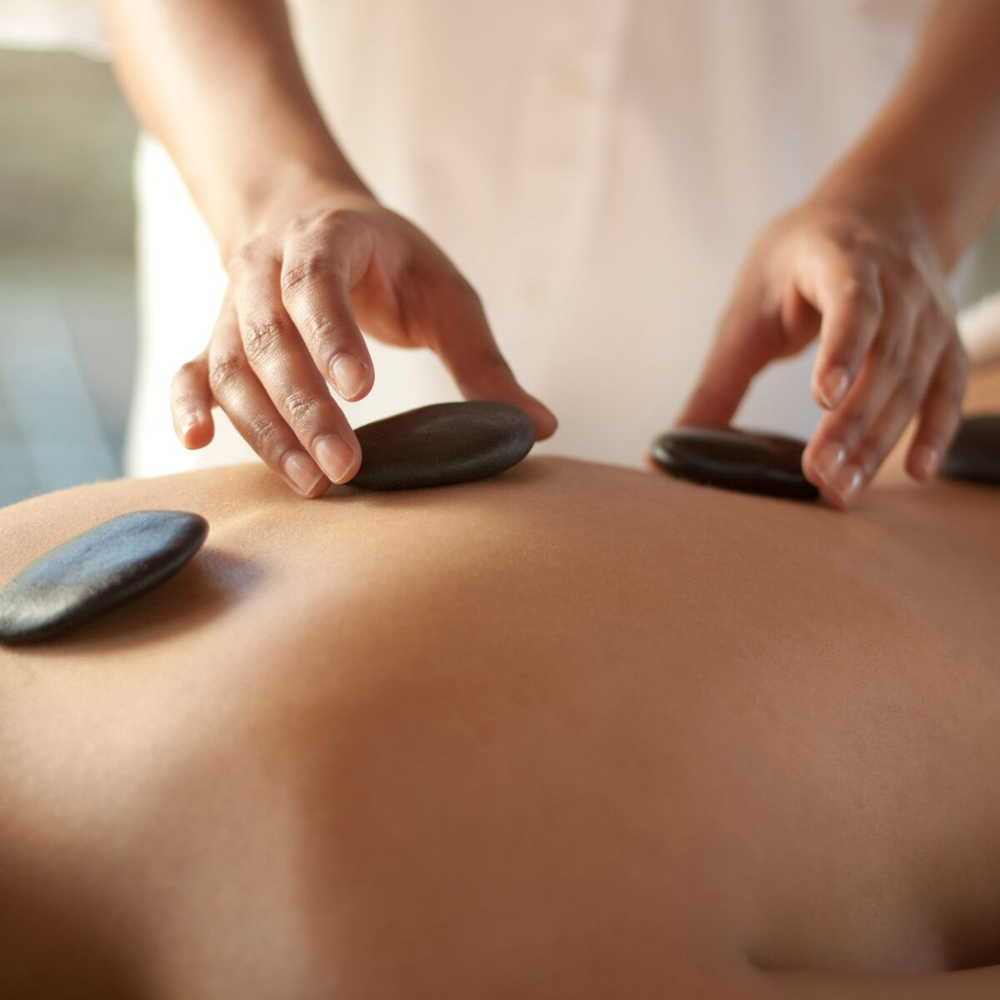
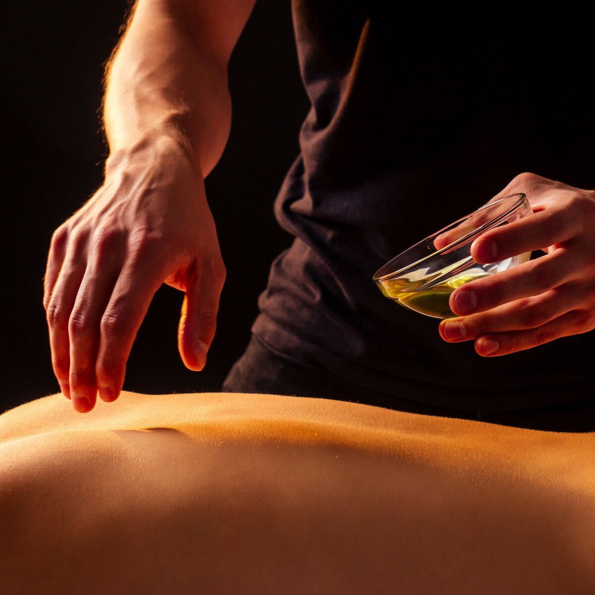

Nhìn menu spa với hàng loạt tên gọi như massage body, đá nóng, chuyên sâu, hương thơm, vai gáy, foot… nhiều người không biết chọn gì, cuối cùng chọn đại hoặc chọn gói rẻ nhất. Thật ra, mỗi loại massage được thiết kế cho một nhu cầu khác nhau. Chọn đúng loại, bạn sẽ thấy hiệu quả rõ hơn rất nhiều. Bài viết này giải thích ngắn gọn từng loại, kèm bảng so sánh để bạn chọn nhanh.

## Bảng so sánh nhanh

| Loại massage | Lực tay | Cảm giác | Phù hợp với |
|---|---|---|---|
| **Massage tinh dầu (body)** | Nhẹ – vừa | Êm, trôi, thư giãn | Người mới, muốn thư giãn |
| **Massage đá nóng** | Vừa | Ấm, giãn cơ sâu mà không đau | Người hay lạnh, cơ cứng, sợ lực mạnh |
| **Massage chuyên sâu** | Mạnh | Tác động sâu, có thể hơi ê | Người đau mỏi nhiều, quen massage |
| **Liệu pháp hương thơm** | Nhẹ | Thư thái tinh thần | Người căng thẳng, khó ngủ |
| **Massage vai gáy** | Vừa – mạnh | Tập trung một vùng | Dân văn phòng |
| **Massage chân** | Vừa | Ấm, nhẹ chân | Người đứng, đi lại nhiều |

## Massage tinh dầu (Massage Body)

Kỹ thuật viên dùng tinh dầu, xoa bóp toàn thân bằng các động tác dài, nhịp nhàng, lướt theo chiều cơ. Lực tay vừa phải, có thể điều chỉnh theo ý bạn. Tinh dầu giúp tay trơn mượt trên da, đồng thời mang lại hương thơm dễ chịu.

**Phù hợp:** người lần đầu đi massage, người muốn thư giãn sau tuần làm việc, người không thích lực mạnh.

**Tại Mandala:** Massage Body – **249.000đ**.

## Massage đá nóng

Kết hợp xoa bóp với **đá bazan được làm ấm**. Kỹ thuật viên đặt đá dọc sống lưng, lòng bàn tay, và dùng đá để miết dọc cơ. Hơi nóng giúp cơ thả lỏng nhanh nên không cần dùng lực quá mạnh mà vẫn tác động sâu. Đặc biệt dễ chịu vào những ngày se lạnh của Tây Nguyên.

**Phù hợp:** người hay lạnh tay chân, cơ căng cứng nhưng sợ đau, người muốn thư giãn sâu.

**Tại Mandala:** **349.000đ**. Đọc thêm: [Massage đá nóng có tác dụng gì?](/blog/massage-da-nong-co-tac-dung-gi/)

## Massage chuyên sâu (Deep tissue)

Kỹ thuật viên dùng **lực mạnh, chậm**, có thể dùng cả khuỷu tay, cẳng tay để tác động vào lớp cơ sâu và các điểm co cứng ("nút thắt" cơ). Trong lúc làm có thể hơi ê ở chỗ cơ căng, và 1–2 ngày sau còn cảm giác ê nhẹ. Điều này bình thường, nhưng **không nên đau nhói**.

**Phù hợp:** người đau mỏi lâu ngày, lao động nặng, chơi thể thao, người đã quen massage và thích lực mạnh.

**Tại Mandala:** Body Chuyên Sâu – **399.000đ**; Body Chuyên Sâu Ngự Y kết hợp thảo dược – **599.000đ**.

## Còn massage Thái thì sao?

Massage Thái là phương pháp truyền thống của Thái Lan, thiên về **bấm huyệt và kéo giãn** cơ thể theo nhiều tư thế. **Mandala hiện không có dịch vụ massage Thái.** Nếu bạn cứng mỏi nhiều và muốn lực tay sâu, hãy chọn **Body Chuyên Sâu** hoặc **Massage Cổ – Vai – Gáy (Cung phẩm Ngự Y)**; nếu chỉ cần thư giãn nhẹ nhàng, **Massage Body tinh dầu** là lựa chọn dễ chịu nhất. Kỹ thuật viên sẽ tư vấn thêm dựa trên tình trạng cơ thể của bạn.

Nếu bạn yêu thích cảm giác được kéo giãn của massage Thái, có thể kết hợp Body Chuyên Sâu tại Mandala với vài động tác giãn cơ đơn giản tại nhà mỗi sáng để cơ thể luôn linh hoạt.

## Liệu pháp hương thơm (Aromatherapy)

Massage nhẹ nhàng kết hợp **tinh dầu thiên nhiên chọn theo tâm trạng**, như oải hương giúp dễ ngủ, sả chanh giúp tỉnh táo, cam ngọt giúp vui vẻ. Hương thơm và động tác chậm giúp tâm trí lắng lại.

**Phù hợp:** người căng thẳng, lo âu, khó ngủ, muốn thư giãn tinh thần hơn là xử lý đau mỏi.

**Tại Mandala:** **499.000đ**.

## Massage vai gáy

Tập trung vào **cổ – vai – gáy – lưng trên**, nơi dân văn phòng hay đau mỏi nhất. Thời gian ngắn hơn massage toàn thân, tác động kỹ hơn vào vùng này.

**Tại Mandala:** Vai Gáy Chuyên Sâu – **299.000đ**; hoặc Massage Cổ – Vai – Gáy Chuyên Sâu (Cung phẩm Ngự Y) – **499.000đ**, kết hợp thảo dược ấm và lăn ống đồng. Tìm hiểu thêm: [Lăn ống đồng thảo dược là gì?](/blog/lan-ong-dong-thao-duoc-la-gi/)

## Massage chân (Foot massage)

Ngâm chân nước thảo dược ấm, sau đó bấm huyệt và xoa bóp bàn chân, bắp chân. Bàn chân có nhiều huyệt đạo theo quan niệm Đông y, massage chân giúp cả cơ thể cảm thấy nhẹ nhõm.

**Phù hợp:** người đứng, đi lại nhiều, du khách sau ngày tham quan.

## Chọn thế nào cho nhanh?

- **Lần đầu, chỉ muốn thư giãn** → Massage tinh dầu
- **Cơ cứng nhưng sợ đau** → Đá nóng
- **Đau mỏi nhiều, đã quen massage** → Chuyên sâu
- **Cứng khớp, ít vận động** → Body Chuyên Sâu, kết hợp vận động giãn cơ tại nhà
- **Căng thẳng, mất ngủ** → Hương thơm
- **Chỉ mỏi cổ vai** → Vai gáy
- **Mỏi chân** → Foot massage

## Có nên kết hợp nhiều loại trong một buổi?

Có. Nhiều khách chọn **kết hợp** để tận dụng thời gian: massage body rồi gội đầu dưỡng sinh, hoặc ngâm thảo dược trước khi massage đá nóng. Các combo tại Mandala được thiết kế sẵn theo hướng này, giúp bạn thư giãn trọn vẹn từ đầu đến chân mà không phải tự sắp xếp. Nếu chưa biết chọn gì, hãy kể cho lễ tân nghe tình trạng cơ thể và thời gian bạn có, Mandala sẽ gợi ý lộ trình phù hợp.

Dù chọn loại nào, hãy nhớ rằng **lực tay mạnh không đồng nghĩa với hiệu quả hơn**. Massage tốt là massage vừa với cơ thể bạn, khiến cơ thả lỏng chứ không gồng lên chống lại. Đừng ngại nói "nhẹ hơn" hoặc "mạnh hơn" trong lúc làm.

## Lưu ý chung cho mọi loại massage

Hãy báo kỹ thuật viên nếu bạn mang thai, có bệnh tim mạch, huyết áp, tiểu đường, giãn tĩnh mạch, chấn thương gần đây hoặc bệnh ngoài da. Massage là liệu pháp thư giãn, **không thay thế** điều trị y khoa.

Vẫn phân vân? Đọc thêm [Lần đầu đi massage: nên chọn loại nào?](/blog/lan-dau-di-massage/) hoặc nhắn Zalo **0395 546 979**, mô tả tình trạng, Mandala tư vấn miễn phí.

[Xem tất cả liệu trình massage](/dich-vu/massage-tri-lieu/) · [Bảng giá](/bang-gia/) · [Đặt lịch online](/lien-he/#dat-lich)
