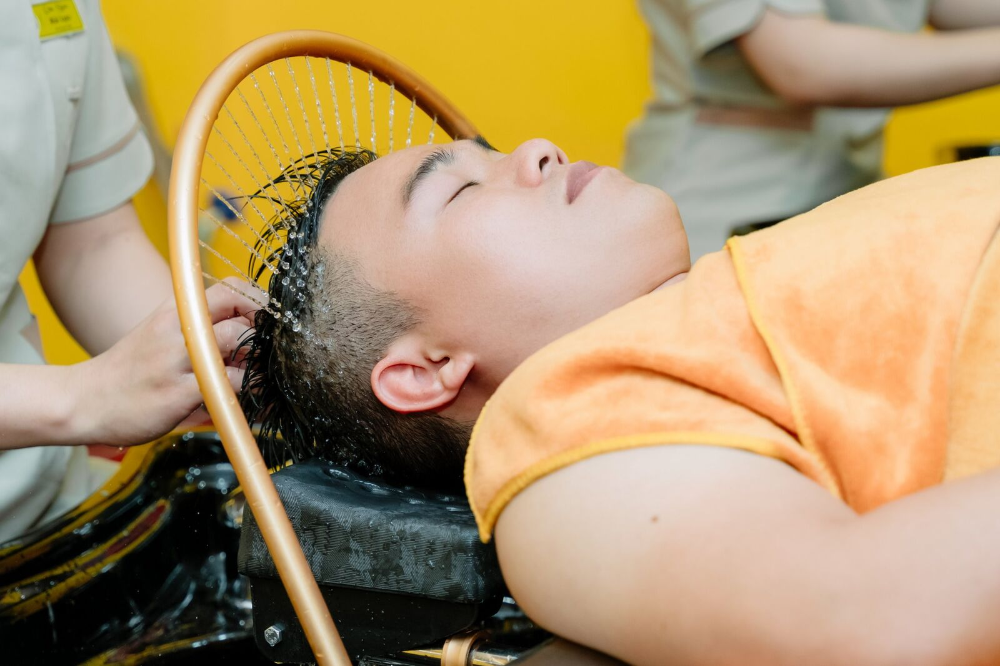

Gõ "gội đầu dưỡng sinh gần đây" mỗi khi đầu nặng, vai mỏi đã trở thành thói quen của rất nhiều người ở Buôn Ma Thuột. Nhưng khi đến nơi, câu hỏi tiếp theo thường là: *gói nào phù hợp với mình, giá bao nhiêu, mất bao lâu và có gì khác so với gội ở tiệm tóc?* Bài viết này giúp bạn hiểu rõ từng gói tại Mandala để chọn đúng ngay từ lần đầu, không tốn thời gian thử sai.

## Gội đầu dưỡng sinh khác gội đầu ở tiệm tóc thế nào?

Ở tiệm tóc, gội đầu chủ yếu để làm sạch trước khi cắt, uốn hoặc tạo kiểu. Thời gian ngắn, động tác nhanh, mục tiêu là mái tóc sạch.

Gội đầu dưỡng sinh thì khác. Đây là một **nghi thức chăm sóc vùng đầu – cổ – vai** dựa trên quan niệm của y học cổ truyền phương Đông: vùng đầu tập trung nhiều huyệt đạo, khi được tác động đúng cách sẽ giúp cơ thể thả lỏng, tinh thần nhẹ nhõm. Một buổi gội dưỡng sinh thường gồm làm sạch bằng nước thảo dược ấm, day ấn huyệt vùng đầu, massage cổ vai gáy, massage mặt và ủ ấm. Mục tiêu không chỉ là mái tóc sạch, mà là **đầu óc nhẹ nhõm, cơ thể được nghỉ ngơi thật sự**.

Bạn có thể đọc kỹ hơn về nguồn gốc và lợi ích trong bài [Gội đầu dưỡng sinh là gì? 5 lợi ích và quy trình chuẩn](/blog/goi-dau-duong-sinh-la-gi/).

## Bảng giá gội đầu dưỡng sinh tại Mandala

| Gói | Phù hợp với | Giá |
|---|---|---|
| **Gội Đầu Thư Giãn** | Muốn gội sạch, thư giãn nhẹ, ít thời gian | 69.000đ |
| **Gội Đầu Dưỡng Sinh** | Hay đau đầu, mỏi cổ vai, cần thư giãn sâu hơn | 159.000đ |
| **Gội Đầu Trung Hoa** | Muốn trải nghiệm trọn vẹn nhiều bước theo phương pháp cổ truyền | 239.000đ |
| **Chăm Sóc Vùng Đầu** | Căng thẳng kéo dài, muốn chăm sóc chuyên sâu da đầu và vai gáy | 399.000đ |

*Giá niêm yết tại Mandala, đã gồm trà thảo mộc đón tiếp. Giá có thể thay đổi, vui lòng xác nhận khi đặt lịch.*

## Nên chọn gói nào? Gợi ý theo từng nhu cầu

### Bạn chỉ có ít thời gian, muốn "làm mới" giữa ngày

Chọn **Gội Đầu Thư Giãn (69.000đ)**. Gói này gội sạch và massage đầu nhẹ nhàng, rất hợp giờ nghỉ trưa, trước một buổi hẹn hoặc sau khi đi đường bụi. Đây cũng là gói "làm quen" lý tưởng nếu bạn chưa từng gội dưỡng sinh và muốn thử trước.

### Bạn hay đau đầu, mỏi gáy vì ngồi máy tính

Chọn **Gội Đầu Dưỡng Sinh (159.000đ)**. Phần bấm huyệt đầu – cổ – vai được chú trọng hơn, kỹ thuật viên sẽ hỏi vùng nào hay căng để tập trung xử lý. Nhiều khách văn phòng chọn gói này làm "liệu trình định kỳ" mỗi tuần một lần.

### Bạn muốn trải nghiệm đầy đủ, thư giãn thật sự

Chọn **Gội Đầu Trung Hoa (239.000đ)**. Quy trình nhiều bước, thời gian dài hơn, có thêm các bước chăm sóc tỉ mỉ. Đây là gói nhiều khách chọn cho lần đầu đến Mandala, hoặc khi muốn tự thưởng sau một tuần làm việc căng thẳng. Bạn có thể so sánh chi tiết trong bài [Gội đầu Trung Hoa khác gội đầu dưỡng sinh thế nào?](/blog/goi-dau-trung-hoa-khac-goi-dau-duong-sinh/)

### Bạn căng thẳng, mất ngủ kéo dài, vai gáy cứng nhiều

Chọn **Chăm Sóc Vùng Đầu (399.000đ)**. Đây là liệu trình chuyên sâu nhất, dành nhiều thời gian cho da đầu và vùng vai gáy. Nếu bạn đang trải qua giai đoạn áp lực công việc, khó ngủ, gói này giúp cơ thể có một khoảng nghỉ dài hơn. Tham khảo thêm: [Mất ngủ, đau đầu vì căng thẳng: gội đầu dưỡng sinh có giúp được không?](/blog/goi-dau-duong-sinh-giup-ngu-ngon/)

Chưa chắc chắn? Nhắn Zalo **0395 546 979**, mô tả tình trạng của bạn, Mandala sẽ tư vấn miễn phí.

## Quy trình gội đầu dưỡng sinh tại Mandala

Mỗi gói có số bước khác nhau, nhưng một buổi gội dưỡng sinh đầy đủ thường diễn ra như sau:

1. **Trà gừng ấm đón tiếp.** Chén trà gừng – quế – sả giúp cơ thể ấm lên và thả lỏng ngay khi bước vào.
2. **Tư vấn nhanh.** Kỹ thuật viên hỏi về tình trạng đau đầu, mất ngủ, da đầu, lực tay mong muốn.
3. **Massage khởi động.** Day nhẹ vùng cổ, vai, gáy để cơ bắt đầu thả lỏng.
4. **Gội thảo dược.** Làm sạch tóc và da đầu với nước ấm và dầu gội thảo dược.
5. **Day ấn huyệt vùng đầu.** Tác động lần lượt các vùng thái dương, đỉnh đầu, chân tóc gáy với nhịp chậm, đều.
6. **Massage mặt, ủ ấm** (tùy gói).
7. **Sấy khô và nghỉ ngơi** với trà thảo mộc trước khi ra về.

## Vì sao khách chọn gội đầu dưỡng sinh tại Mandala?

- **Không gian riêng tư, yên tĩnh.** Khu gội đầu tách biệt, ánh sáng dịu, khăn cuộn sẵn sạch sẽ.
- **Thảo dược tự nhiên.** Gừng, sả, quế được dùng cho cả trà đón khách và nước thảo dược.
- **Giá niêm yết rõ ràng.** Không phát sinh phụ phí, khách biết trước mình trả bao nhiêu.
- **Mở cửa 10:00 – 22:00 hằng ngày.** Tiện ghé sau giờ làm hoặc buổi tối cuối tuần.
- **Vị trí trung tâm.** 86 Hàn Mặc Tử, Phường Buôn Ma Thuột, Đắk Lắk, dễ tìm, dễ đi.
- **Đón cả khách du lịch.** Mandala thường xuyên đón du khách trong và ngoài nước ghé thư giãn sau hành trình.

## Kinh nghiệm để buổi gội trọn vẹn hơn

- **Đặt lịch trước**, nhất là buổi tối và cuối tuần, để không phải chờ.
- **Ăn nhẹ trước khoảng 1 giờ**, không nên gội khi quá no hoặc quá đói.
- **Tháo trang sức, kẹp tóc** trước khi nằm.
- **Báo trước** nếu bạn có vết thương vùng đầu, bệnh lý da đầu, huyết áp không ổn định, đang mang thai hoặc vừa uốn, nhuộm tóc.
- **Tạm cất điện thoại.** Liệu trình phát huy tác dụng tốt nhất khi bạn thật sự nghỉ ngơi.
- **Sấy tóc thật khô** trước khi ra về, đặc biệt những tối se lạnh ở Tây Nguyên.

Muốn biết nên gội bao lâu một lần, bạn đọc thêm bài [Gội đầu dưỡng sinh bao lâu một lần?](/blog/goi-dau-duong-sinh-bao-lau-mot-lan/)

## Câu hỏi thường gặp

**Gội đầu dưỡng sinh có cần đặt lịch không?**
Không bắt buộc, nhưng nên đặt trước để được giữ chỗ, đặc biệt từ 18:00 trở đi.

**Nam giới có gội được không?**
Có. Rất nhiều khách nam chọn gội dưỡng sinh để giảm mỏi cổ vai sau giờ làm.

**Có gội cho hai người cùng lúc không?**
Có. Phòng gội có hai giường, phù hợp đi cùng bạn bè, người thân.

## Đặt lịch gội đầu dưỡng sinh tại Mandala

📍 86 Hàn Mặc Tử, Phường Buôn Ma Thuột, Đắk Lắk · 🕙 10:00 – 22:00 hằng ngày · ☎ **0395 546 979** (Zalo)

[Xem chi tiết các gói gội đầu dưỡng sinh](/dich-vu/goi-dau-duong-sinh/) · [Đặt lịch online](/lien-he/#dat-lich)

*Bài viết mang tính tham khảo, không thay thế tư vấn y khoa.*
