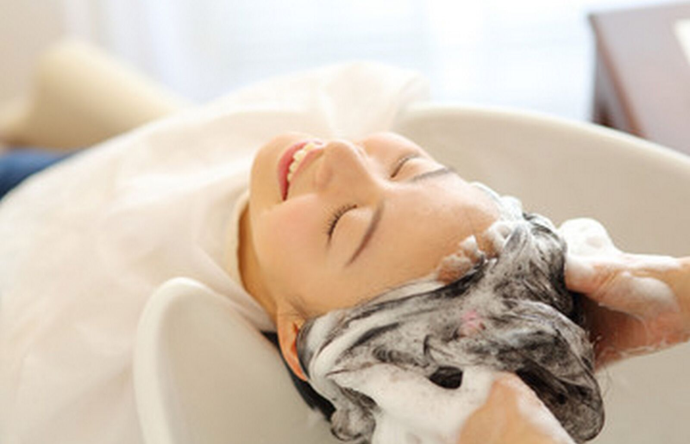

Nằm trằn trọc đến nửa đêm, sáng dậy đầu nặng như đeo đá, vai gáy cứng đờ, cả ngày uể oải… Nếu bạn đang ở trong vòng lặp này, rất có thể **căng thẳng** là nguyên nhân chính. Không ít khách tìm đến Mandala với câu hỏi: "Gội đầu dưỡng sinh có giúp mình ngủ ngon hơn không?" Câu trả lời trung thực là: **không phải thuốc ngủ, nhưng có thể là một khoảng nghỉ mà cơ thể bạn đang rất cần**.

## Vì sao căng thẳng khiến ta khó ngủ và đau đầu?

Khi căng thẳng kéo dài, cơ thể ở trạng thái "báo động": nhịp tim nhanh hơn, hơi thở nông hơn, cơ bắp gồng lên một cách vô thức. Những vùng chịu ảnh hưởng nhiều nhất là **trán, thái dương, cổ và vai**. Sự căng cứng này gây cảm giác đầu nặng, đau âm ỉ như có dải băng siết quanh đầu, thường được gọi là đau đầu do căng thẳng.

Cùng lúc đó, tâm trí liên tục nghĩ về công việc, hóa đơn, những việc chưa xong. Cơ thể chưa thả lỏng, đầu óc chưa yên, nên dù rất mệt, ta vẫn khó đi vào giấc ngủ sâu. Ngủ không sâu lại khiến hôm sau mệt hơn, dễ căng thẳng hơn. Vòng lặp cứ thế tiếp diễn.

## Gội đầu dưỡng sinh giúp gì?

Gội đầu dưỡng sinh có thể hỗ trợ cơ thể chuyển sang trạng thái thư giãn nhờ nhiều yếu tố cùng lúc:

- **Nước ấm và hương thảo mộc.** Gừng, sả, bồ kết tạo cảm giác dễ chịu, an toàn, khiến cơ thể tự nhiên thả lỏng.
- **Day ấn nhịp nhàng vùng đầu, thái dương, gáy.** Các cơ đang gồng được giải phóng dần.
- **Massage cổ vai gáy.** Đây là nơi tích tụ căng thẳng nhiều nhất, đặc biệt ở người ngồi máy tính.
- **Tư thế nằm ngửa, nhắm mắt.** Cơ thể được nghỉ ngơi hoàn toàn, không phải gồng giữ tư thế.
- **Không gian yên tĩnh, tạm rời điện thoại.** Tâm trí được nghỉ khỏi luồng thông báo liên tục.

Nhiều khách tại Mandala chia sẻ họ **ngủ sâu hơn vào đêm sau buổi gội**, thậm chí ngủ quên ngay trong lúc gội. Tuy nhiên, hiệu quả khác nhau ở mỗi người, và gội đầu chỉ là một phần của bức tranh lớn hơn về giấc ngủ.

## Thời điểm gội tốt nhất cho giấc ngủ

Nếu mục tiêu là ngủ ngon, **buổi tối** là thời điểm lý tưởng. Mandala mở cửa đến 22:00, bạn có thể ghé sau giờ làm, gội xong về nhà nghỉ ngơi luôn. Lưu ý:

- **Sấy tóc thật khô** trước khi về, tránh đi đường với tóc ẩm trong đêm lạnh.
- **Không ăn quá no** ngay trước khi gội.
- **Về nhà nên đi ngủ sớm** để tận dụng trạng thái thư giãn.

## Kết hợp gội đầu với thói quen ngủ tốt

Một buổi gội đầu sẽ phát huy tác dụng tốt hơn nếu bạn kết hợp những thói quen sau:

1. **Hạn chế màn hình 30–60 phút trước khi ngủ.** Ánh sáng điện thoại và nội dung liên tục khiến não khó "tắt máy".
2. **Giờ ngủ cố định**, kể cả cuối tuần. Cơ thể quen nhịp sẽ dễ buồn ngủ đúng giờ.
3. **Tránh cà phê từ buổi chiều.** Điều không dễ ở "thủ phủ cà phê" Buôn Ma Thuột, nhưng rất đáng thử.
4. **Vận động nhẹ trong ngày:** đi bộ 20–30 phút, giãn cơ vai gáy.
5. **Thở chậm 5 phút trước khi ngủ:** hít vào 4 nhịp, thở ra 6 nhịp, lặp lại.
6. **Phòng ngủ tối, mát, yên tĩnh.**
7. **Ghi ra giấy những việc đang lo** trước khi ngủ, để tâm trí không phải "giữ" chúng.

## Những liệu pháp khác có thể hỗ trợ

Ngoài gội đầu, một số liệu trình tại Mandala cũng phù hợp khi bạn căng thẳng:

- **Liệu Pháp Bằng Hương Thơm (499.000đ):** massage nhẹ nhàng với tinh dầu thiên nhiên chọn theo tâm trạng.
- **Massage Body Đá Nóng (349.000đ):** hơi ấm giúp cơ thả lỏng sâu mà không cần lực mạnh.
- **Ngâm thảo dược, xông hơi:** làm ấm cơ thể, thư giãn trước giờ ngủ.

Tìm hiểu thêm: [Massage đá nóng có tác dụng gì?](/blog/massage-da-nong-co-tac-dung-gi/) · [Ngâm chân thảo dược có tác dụng gì?](/blog/ngam-chan-thao-duoc-co-tac-dung-gi/)

## Thói quen buổi tối giúp ngủ ngon hơn

Gội đầu dưỡng sinh mang lại hiệu quả tốt nhất khi đi cùng một vài thói quen nhỏ trước giờ ngủ:

1. **Tắt điện thoại, máy tính** khoảng 30–60 phút trước khi ngủ, vì ánh sáng màn hình khiến não khó "tắt máy".
2. **Hạn chế cà phê sau 14:00.** Ở Buôn Ma Thuột, cà phê là thói quen khó bỏ, nhưng uống buổi chiều tối dễ khiến trằn trọc.
3. **Giữ phòng ngủ tối, mát, yên tĩnh.**
4. **Ngâm chân nước ấm** 15 phút trước khi ngủ, rất dễ chịu những đêm se lạnh.
5. **Đi ngủ và thức dậy đúng giờ**, kể cả cuối tuần.

## Khi nào cần gặp bác sĩ?

Gội đầu dưỡng sinh là liệu pháp thư giãn hỗ trợ, **không thay thế** chẩn đoán và điều trị y khoa. Hãy đi khám nếu bạn gặp:

- Mất ngủ **kéo dài nhiều tuần**, ảnh hưởng rõ đến công việc và sinh hoạt
- Đau đầu **dữ dội, đột ngột**, hoặc kèm buồn nôn, nhìn mờ, yếu tay chân, nói khó
- Đau đầu **ngày càng nặng** hoặc thay đổi tính chất
- Cảm giác **lo âu, buồn chán kéo dài**, mất hứng thú với mọi việc
- Ngáy to, ngưng thở khi ngủ (người thân phát hiện)

Đây là những dấu hiệu cần được bác sĩ đánh giá.

## Gói nào phù hợp khi bạn căng thẳng, khó ngủ?

| Tình trạng | Gợi ý | Giá |
|---|---|---|
| Đầu nặng, mỏi cổ vai sau giờ làm | Gội Đầu Dưỡng Sinh | 159.000đ |
| Căng thẳng nhiều, muốn nghỉ dài | Gội Đầu Trung Hoa | 239.000đ |
| Khó ngủ kéo dài, cần chăm sóc sâu | Chăm Sóc Vùng Đầu | 399.000đ |
| Muốn thư giãn toàn thân | Liệu Pháp Bằng Hương Thơm | 499.000đ |

## Đặt lịch tại Mandala

📍 86 Hàn Mặc Tử, P. Tân An, Buôn Ma Thuột · 🕙 10:00 – 22:00 · ☎ **0395 546 979** (Zalo)

[Xem các gói gội đầu dưỡng sinh](/dich-vu/goi-dau-duong-sinh/) · [Đặt lịch online](/lien-he/#dat-lich)

*Bài viết mang tính tham khảo, không thay thế tư vấn y khoa. Nếu bạn đang gặp vấn đề sức khỏe tinh thần kéo dài, hãy tìm đến bác sĩ hoặc chuyên gia tâm lý.*
