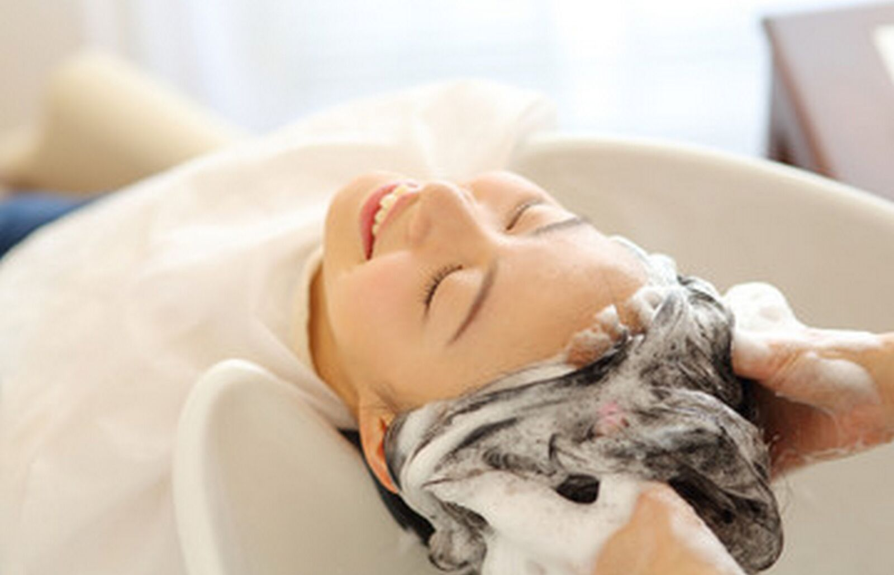

"Gội đầu Trung Hoa" và "gội đầu dưỡng sinh" là hai cái tên khách thường thấy trên menu spa, và cũng là câu hỏi lễ tân Mandala nhận nhiều nhất: *hai loại này khác gì nhau, cái nào tốt hơn?* Câu trả lời ngắn gọn: **cùng một gốc dưỡng sinh phương Đông, khác nhau ở độ sâu, số bước và độ dài của trải nghiệm**. Không có loại nào "tốt hơn", chỉ có loại phù hợp hơn với nhu cầu và thời gian của bạn lúc đó.

## Điểm chung: cùng triết lý dưỡng sinh

Cả hai đều dựa trên quan niệm của y học cổ truyền: vùng đầu tập trung nhiều huyệt đạo và là nơi các đường kinh lạc đi qua. Khi vùng này được chăm sóc đúng cách, khí huyết lưu thông tốt hơn, cơ thể thư giãn và tinh thần nhẹ nhõm. Vì vậy, dù chọn loại nào, bạn đều được:

- Gội bằng **nước ấm và dầu gội thảo dược**
- **Day ấn huyệt** vùng đầu với nhịp chậm, đều
- **Massage cổ – vai – gáy** để giải phóng căng cứng
- Nằm trong **không gian yên tĩnh, ánh sáng dịu**
- Thưởng thức **trà gừng ấm** trước và sau liệu trình

## Khác biệt chính giữa hai liệu trình

| | Gội đầu dưỡng sinh | Gội đầu Trung Hoa |
|---|---|---|
| **Số bước** | Gọn hơn, tập trung vào gội thảo dược và bấm huyệt đầu – cổ – vai | Nhiều bước hơn, thêm các bước chăm sóc tỉ mỉ như massage mặt, ủ ấm, chăm sóc tai, xả nước vòng cung |
| **Thời gian** | Ngắn hơn | Dài hơn, thư giãn trọn vẹn |
| **Cảm giác** | Nhẹ đầu, tỉnh táo | Thư thái sâu, nhiều người ngủ quên trong lúc gội |
| **Phù hợp** | Chăm sóc định kỳ, ghé nhanh sau giờ làm | Lần đầu trải nghiệm, muốn "nghỉ ngơi thật sự", làm quà tặng |
| **Giá tại Mandala** | 159.000đ | 239.000đ |

*Tên gọi và quy trình mỗi spa có thể khác nhau. Bảng trên mô tả các gói tại Mandala Buôn Ma Thuột.*

## Vì sao gọi là "gội đầu Trung Hoa"?

Tên gọi này xuất phát từ phong cách gội đầu dưỡng sinh nhiều bước rất phổ biến ở Trung Quốc. Ở đó, việc gội đầu tại tiệm từ lâu đã được xem như một **nghi thức thư giãn** chứ không đơn thuần là làm sạch. Phong cách này chú trọng sự tỉ mỉ ở từng bước, thời gian dành cho khách dài, nhiều động tác massage đầu, mặt, vai và các bước phụ như chăm sóc tai.

Khi du nhập vào Việt Nam, gội đầu Trung Hoa được các spa điều chỉnh cho phù hợp với khí hậu và thói quen của người Việt, kết hợp thảo dược quen thuộc như bồ kết, sả, gừng, vỏ bưởi.

## Một buổi gội đầu Trung Hoa tại Mandala diễn ra thế nào?

1. **Đón tiếp bằng trà gừng – quế – sả ấm.**
2. **Tư vấn** về tình trạng da đầu, đau đầu, giấc ngủ và lực tay bạn thích.
3. **Massage khởi động** vai gáy, giúp cơ thả lỏng trước khi gội.
4. **Gội thảo dược nhiều lần**, kết hợp massage da đầu.
5. **Xả nước bằng vòi phun vòng cung.** Dòng nước ấm chảy đều quanh chân tóc, tạo cảm giác như mưa nhẹ, rất dễ chịu.
6. **Day ấn huyệt vùng đầu và mặt**, nhẹ nhàng ở thái dương, chân mày, sau tai.
7. **Chăm sóc tai** nhẹ nhàng (tùy gói và nhu cầu).
8. **Ủ ấm, sấy khô** và nghỉ ngơi với trà thảo mộc.

Với gội đầu dưỡng sinh, các bước 5, 7 được rút gọn hoặc lược bỏ, thời gian bấm huyệt vai gáy vẫn được giữ.

## Nên chọn loại nào?

### Chọn gội đầu dưỡng sinh nếu bạn

- Muốn chăm sóc định kỳ 1–2 lần mỗi tuần
- Có khoảng thời gian ngắn giữa hai cuộc hẹn
- Chủ yếu cần giảm mỏi cổ vai, đầu nặng sau giờ làm
- Muốn tối ưu chi phí cho thói quen lâu dài

### Chọn gội đầu Trung Hoa nếu bạn

- **Lần đầu đến spa** và muốn cảm nhận đầy đủ
- Đang rất căng thẳng, muốn một khoảng nghỉ dài
- Muốn **tặng người thân** một trải nghiệm thư giãn trọn vẹn
- Thích cảm giác được chăm sóc tỉ mỉ từng chi tiết

Nếu vẫn phân vân, hãy bắt đầu với **gội đầu Trung Hoa** cho lần đầu, sau đó duy trì bằng **gội đầu dưỡng sinh**. Đây là cách nhiều khách quen của Mandala đang làm: lần đầu để "biết thế nào là thư giãn trọn vẹn", các lần sau để giữ thói quen chăm sóc bản thân với chi phí hợp lý.

## Ngoài ra còn hai lựa chọn khác

- **Gội Đầu Thư Giãn (69.000đ):** gọn nhất, gội sạch và massage đầu nhẹ. Hợp khi bạn chỉ cần "làm mới" nhanh.
- **Chăm Sóc Vùng Đầu (399.000đ):** chuyên sâu nhất, dành nhiều thời gian cho da đầu và vai gáy. Hợp khi căng thẳng, khó ngủ kéo dài.

Xem đầy đủ trong bài [Gội đầu dưỡng sinh ở Buôn Ma Thuột: giá và cách chọn gói](/blog/goi-dau-duong-sinh-buon-ma-thuot/).

## Ai cần lưu ý trước khi gội?

Hãy báo trước với kỹ thuật viên nếu bạn:

- Có vết thương, bệnh lý da đầu (viêm da, nấm, vảy nến…)
- Huyết áp không ổn định, hay chóng mặt khi nằm ngửa lâu
- Đang mang thai
- Vừa uốn, nhuộm tóc trong vài ngày gần đây
- Đau đầu dữ dội, đột ngột (trường hợp này nên đi khám trước)

Gội đầu dưỡng sinh và gội đầu Trung Hoa đều là liệu pháp thư giãn, **không thay thế** việc khám và điều trị y khoa.

## Câu hỏi thường gặp

**Gội đầu Trung Hoa có làm hư tóc không?**
Không. Dầu gội thảo dược nhẹ dịu, phù hợp gội thường xuyên. Nếu tóc bạn vừa làm hóa chất, hãy báo trước để kỹ thuật viên chọn sản phẩm phù hợp.

**Chăm sóc tai có đau không?**
Không. Động tác nhẹ nhàng, chủ yếu để thư giãn. Bạn có thể từ chối bước này nếu không thích.

**Có sấy tạo kiểu không?**
Mandala sấy khô tóc sau gội; nếu muốn tạo kiểu cầu kỳ, bạn nên báo trước.

## Trải nghiệm tại Mandala Buôn Ma Thuột

Mandala có đủ 4 gói gội đầu từ **69.000đ** đến **399.000đ**, khu gội riêng tư, mở cửa **10:00 – 22:00** hằng ngày tại 86 Hàn Mặc Tử.

[Xem chi tiết các gói gội đầu](/dich-vu/goi-dau-duong-sinh/) · [Đặt lịch online](/lien-he/#dat-lich) · Gọi/Zalo **0395 546 979**
