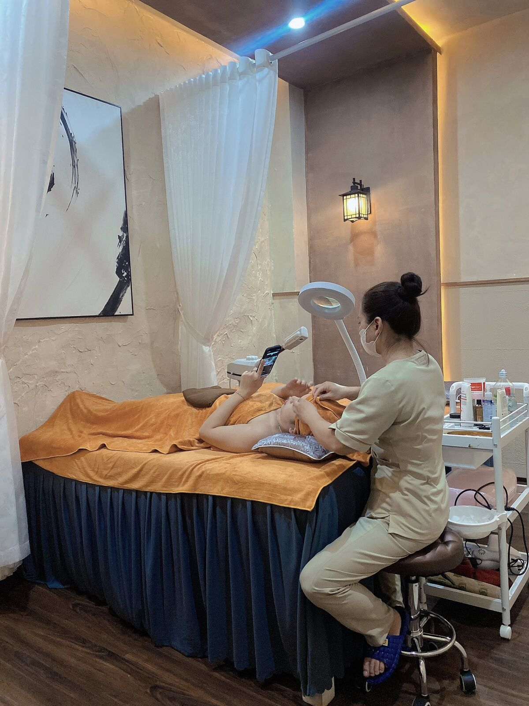
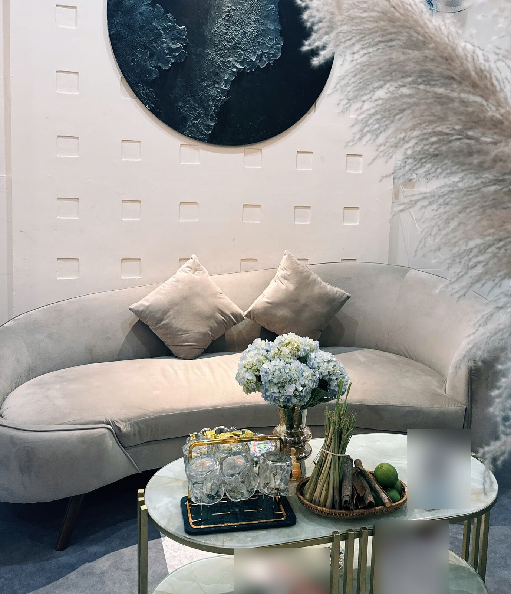

Buôn Ma Thuột ngày càng có nhiều spa, tiệm massage và gội đầu dưỡng sinh. Lựa chọn nhiều là điều tốt, nhưng cũng khiến không ít người băn khoăn: *nơi nào sạch sẽ, giá minh bạch, kỹ thuật viên có tay nghề, mình có được tôn trọng không?* Một trải nghiệm không tốt có thể khiến bạn ngại đi spa luôn. Dưới đây là 7 điều nên kiểm tra trước khi chọn, cùng một checklist ngắn để bạn mang theo.

## 1. Giá niêm yết rõ ràng

Một spa uy tín luôn **công khai bảng giá**: trên website, fanpage hoặc ngay tại quầy lễ tân. Khách biết trước mình trả bao nhiêu, không có cảm giác "bị hớ".

Hãy cẩn trọng với nơi:
- Không báo giá trước, chỉ nói "vào làm rồi tính"
- Báo giá rất thấp để thu hút, rồi phát sinh nhiều "phụ phí" sau khi làm
- Giá trên mạng và giá tại chỗ khác nhau

✔ **Nên hỏi rõ:** giá đã gồm những gì (trà, khăn, sản phẩm)? Có phụ thu ngày lễ, giờ muộn không? Thanh toán bằng hình thức nào?

## 2. Đánh giá thật trên Google Maps

Mở Google Maps, tìm tên spa, xem **điểm đánh giá, số lượng đánh giá** và **đọc những đánh giá gần đây**.

- Nhiều đánh giá **chi tiết**, nhắc đến dịch vụ cụ thể ("gội đầu Trung Hoa rất thư giãn", "kỹ thuật viên hỏi kỹ lực tay") thường đáng tin hơn vài lời khen chung chung.
- Xem spa **phản hồi đánh giá chưa tốt** như thế nào. Một nơi cầu thị sẽ trả lời lịch sự, nhận góp ý.
- Để ý **thời gian** của đánh giá. Đánh giá từ vài năm trước có thể không còn phản ánh hiện tại.

## 3. Vệ sinh sạch sẽ

Đây là điều bạn **có thể quan sát ngay** khi bước vào:

- Khăn, ga **thay mới cho từng khách**, không có mùi ẩm
- Dụng cụ như đá nóng, ống đồng, dụng cụ gội đầu được **vệ sinh sau mỗi lượt**
- Phòng thơm mát, không ẩm mốc, sàn khô ráo
- Khu gội đầu, nhà vệ sinh sạch sẽ
- Kỹ thuật viên mặc đồng phục gọn gàng, rửa tay trước khi làm

Nếu thấy khăn cũ, phòng bí, mùi lạ, đừng ngại đổi nơi khác.

## 4. Có tư vấn trước khi làm

Kỹ thuật viên chuyên nghiệp sẽ **hỏi tình trạng sức khỏe, vùng đau mỏi, lực tay mong muốn** trước khi bắt đầu. Đây không chỉ là phép lịch sự mà còn là để đảm bảo an toàn cho bạn.

Dấu hiệu cần cân nhắc:
- Bỏ qua hoàn toàn bước hỏi han
- Liên tục **ép mua thêm gói**, thẻ liệu trình ngay trong lúc làm
- Không điều chỉnh khi bạn báo đau

## 5. Không gian riêng tư, tôn trọng khách

- Phòng trị liệu riêng hoặc có rèm che kín
- Khách được thay đồ riêng tư, có đồ thay sạch
- **Vùng cơ thể không massage luôn được phủ khăn**
- Bạn luôn có quyền **yêu cầu dừng hoặc điều chỉnh** bất cứ lúc nào
- Có lựa chọn phòng đôi khi đi cùng người thân

## 6. Biết rõ giới hạn chuyên môn

Một spa đáng tin sẽ **nói rõ những trường hợp không nên làm**: mang thai, bệnh lý nền, vết thương hở, bệnh ngoài da… Họ cũng **không hứa hẹn "chữa khỏi bệnh"**, "giảm 5kg sau 1 buổi" hay những cam kết thiếu cơ sở.

Massage, gội đầu dưỡng sinh, liệu pháp Đông y tại spa là liệu pháp **thư giãn, hỗ trợ sức khỏe**, không thay thế bác sĩ. Nơi nào nói rõ điều này là nơi trung thực với khách.

## 7. Thuận tiện: vị trí, giờ mở cửa, đặt lịch

- **Vị trí** dễ tìm, có chỗ gửi xe
- **Giờ mở cửa** phù hợp lịch của bạn. Nhiều người chỉ rảnh sau 19:00
- **Đặt lịch dễ dàng:** gọi, Zalo, đặt online
- **Xác nhận lịch hẹn** rõ ràng

## Những dấu hiệu nên cân nhắc lại

Bên cạnh tiêu chí tốt, cũng có vài dấu hiệu khiến bạn nên cân nhắc trước khi chọn một spa:

- **Giá quá rẻ bất thường** so với mặt bằng chung, kèm lời mời chào dồn dập.
- **Không có bảng giá rõ ràng**, hoặc giá thay đổi khi bạn đã nằm lên giường.
- **Ép mua thẻ liệu trình, sản phẩm** ngay buổi đầu.
- **Không hỏi gì về sức khỏe** trước khi làm, nhất là với các liệu pháp dùng nhiệt, giác hơi.
- **Khăn, ga không sạch**, phòng ẩm mốc, có mùi lạ.
- **Đánh giá trên Google chỉ toàn lời khen ngắn**, mới tạo, không có hình thật của khách.

Một spa tốt sẽ luôn để bạn **chủ động lựa chọn**, giải thích rõ ràng và không tạo áp lực.

## Buổi đầu tiên: hãy bắt đầu nhẹ nhàng

Nếu chưa quen một spa, hãy thử một liệu trình ngắn như gội đầu dưỡng sinh hoặc massage vai gáy trước. Đây là cách dễ nhất để cảm nhận tay nghề kỹ thuật viên, sự sạch sẽ và cách phục vụ, trước khi quyết định quay lại cho các liệu trình dài hơn.

## Checklist nhanh trước khi đặt lịch

- [ ] Đã xem bảng giá công khai
- [ ] Đã đọc 5–10 đánh giá gần đây trên Google Maps
- [ ] Biết rõ liệu trình gồm những gì, bao lâu
- [ ] Đã hỏi về phụ phí
- [ ] Biết giờ mở cửa và cách đặt lịch
- [ ] Đã chuẩn bị thông tin sức khỏe để báo kỹ thuật viên

## Mandala đáp ứng những điều này như thế nào?

| Tiêu chí | Tại Mandala |
|---|---|
| Giá niêm yết | [Bảng giá công khai](/bang-gia/) trên website, massage từ 249.000đ, gội đầu từ 69.000đ |
| Đánh giá | Xem trên Google Maps "Mandala – Healthcare & Spa" |
| Vệ sinh | Khăn, ga thay mới cho từng khách, dụng cụ vệ sinh sau mỗi lượt |
| Tư vấn | Hỏi thể trạng và lực tay trước mỗi liệu trình |
| Riêng tư | Phòng riêng, phòng đôi, rèm che |
| Giới hạn | Ghi rõ lưu ý và chống chỉ định cho từng dịch vụ |
| Thuận tiện | 86 Hàn Mặc Tử, có chỗ đậu ô tô và xe máy, mở cửa 10:00 – 22:00, đặt lịch online |
| Quà tặng | Có thẻ quà tặng cho người thân, bạn bè |

Cách tốt nhất để đánh giá một spa là **tự trải nghiệm một liệu trình nhỏ** trước, ví dụ gội đầu thư giãn 69.000đ hoặc massage vai gáy. Nếu thấy hài lòng, bạn có thể thử các liệu trình khác. Lần đầu đi massage? Đọc thêm [cẩm nang cho người mới](/blog/lan-dau-di-massage/).

[Đặt lịch tại Mandala](/lien-he/#dat-lich) · [Xem dịch vụ](/dich-vu/) · Gọi/Zalo **0395 546 979**
