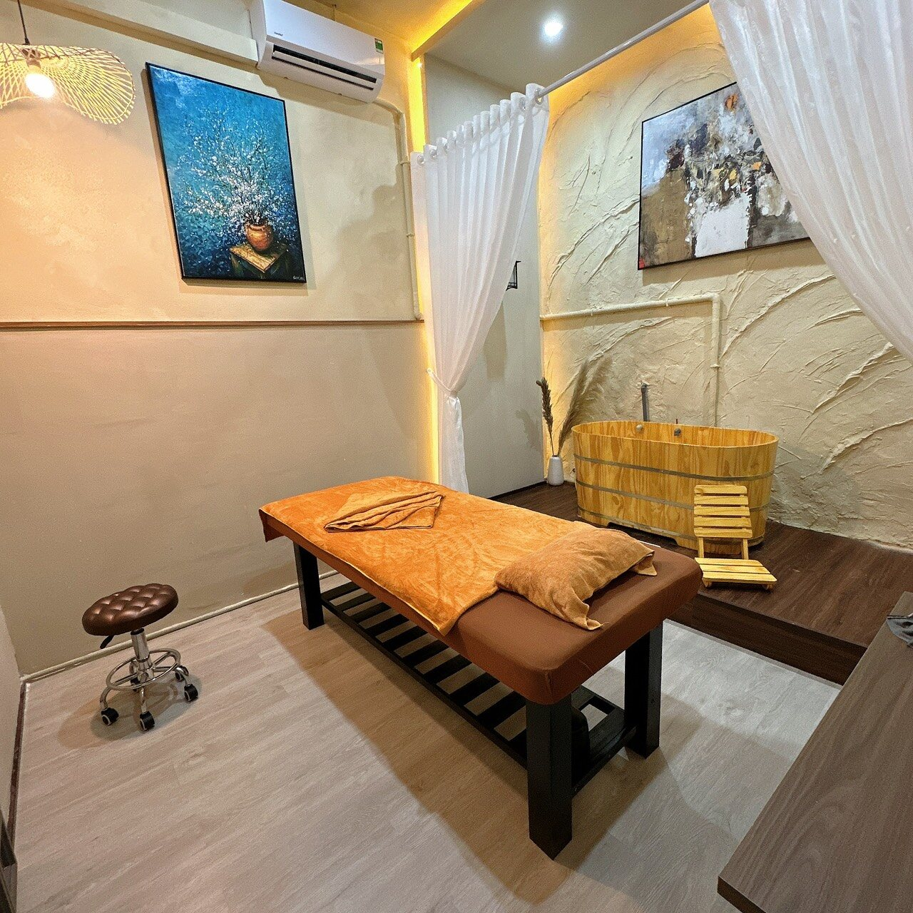

Lần đầu đi massage, hầu như ai cũng có chút ngại ngùng: *Không biết chọn gói nào? Có phải cởi đồ không? Lỡ đau thì sao? Có nên nói chuyện với kỹ thuật viên không?* Đó là những băn khoăn rất bình thường. Bài viết này đi qua từng bước, từ lúc chọn gói đến lúc ra về, để buổi massage đầu tiên của bạn thật thoải mái và đáng nhớ.

## 1. Chọn loại massage phù hợp

Mỗi loại massage có lực tay, cảm giác và mục đích khác nhau. Dưới đây là gợi ý theo tình trạng của bạn:

| Bạn đang… | Gợi ý tại Mandala | Giá |
|---|---|---|
| Muốn thư giãn nhẹ nhàng, lần đầu thử | **Massage Body** (tinh dầu, lực vừa) | 249.000đ |
| Hay lạnh tay chân, cơ căng cứng, sợ lực mạnh | **Massage Body Đá Nóng** | 349.000đ |
| Đau mỏi nhiều, đã quen massage lực mạnh | **Body Chuyên Sâu** | 399.000đ |
| Chỉ mỏi cổ vai gáy | **Vai Gáy Chuyên Sâu** | 299.000đ |
| Căng thẳng, khó ngủ | **Liệu Pháp Bằng Hương Thơm** | 499.000đ |
| Đứng, đi lại nhiều, mỏi chân | **Massage Foot** | Liên hệ |

**Lời khuyên cho lần đầu:** hãy chọn **Massage Body** hoặc **Massage Đá Nóng**. Lực vừa phải, dễ chịu, giúp bạn làm quen với cảm giác massage. Khi đã quen và biết cơ thể mình thích gì, bạn có thể thử các liệu trình chuyên sâu hơn. So sánh chi tiết các loại trong bài [Các loại massage khác nhau thế nào?](/blog/cac-loai-massage-khac-nhau-the-nao/)

## 2. Trước khi đến spa

- **Đặt lịch trước.** Gọi, nhắn Zalo hoặc đặt online, đến đúng giờ để không bị rút ngắn thời gian liệu trình.
- **Ăn nhẹ trước khoảng 1 tiếng.** Massage khi quá no dễ khó chịu khi nằm sấp, quá đói lại dễ chóng mặt.
- **Tắm rửa trước** nếu tiện, tránh xịt nước hoa quá nồng.
- **Không uống rượu bia** trước khi massage.
- **Đến sớm 10 phút** để thay đồ, uống trà, nói chuyện với kỹ thuật viên mà không vội.
- **Mặc đồ thoải mái**, dễ thay.

## 3. Mặc gì? Có phải cởi đồ không?

Đây là câu hỏi khiến nhiều người ngại nhất. Tại Mandala, bạn được **thay đồ trong phòng riêng**, có khăn sạch và đồ thay chuẩn bị sẵn. Trong lúc massage, **vùng cơ thể không được massage luôn được phủ khăn**, kỹ thuật viên chỉ mở phần cần làm.

Bạn hoàn toàn có thể **giữ lại đồ lót**. Nếu chưa quen, cứ nói với kỹ thuật viên. Sự thoải mái của bạn là ưu tiên số một, không có quy định "bắt buộc" nào cả.

## 4. Nói gì với kỹ thuật viên?

Trước khi bắt đầu, kỹ thuật viên sẽ hỏi vài câu. Đừng ngại chia sẻ:

- **Vùng đang đau mỏi:** vai, cổ, lưng dưới, chân…
- **Lực tay mong muốn:** nhẹ, vừa hay mạnh. Lần đầu nên chọn vừa.
- **Tình trạng sức khỏe:** đang mang thai, bệnh tim mạch, huyết áp, tiểu đường, chấn thương gần đây, bệnh ngoài da, giãn tĩnh mạch.
- **Vùng không muốn massage:** ví dụ bụng, mặt, chân.
- **Mùi tinh dầu** bạn thích hoặc không thích.

Trong lúc massage, nếu thấy **đau hoặc khó chịu**, hãy nói ngay. Massage đúng cách có thể hơi ê ở chỗ cơ căng, nhưng **không nên đau nhói**. Kỹ thuật viên luôn sẵn sàng điều chỉnh.

## 5. Trong buổi massage

- **Thả lỏng, thở đều.** Đừng gồng người, cứ để cơ thể mềm ra.
- **Muốn im lặng hay trò chuyện đều được.** Nhiều khách chọn nhắm mắt nghỉ ngơi, thậm chí ngủ quên. Điều đó hoàn toàn bình thường.
- **Tắt chuông điện thoại** để tận hưởng trọn vẹn.
- **Nếu lạnh**, hãy nói để được đắp thêm khăn hoặc chỉnh nhiệt độ phòng.

## 6. Sau khi massage

- **Nằm nghỉ vài phút** trước khi ngồi dậy, tránh đứng lên đột ngột.
- **Uống nước ấm** hoặc trà thảo mộc.
- Có thể thấy **hơi ê nhẹ** ở vùng cơ được tác động sâu. Cảm giác này thường hết sau 1–2 ngày.
- **Tránh tắm nước lạnh ngay**, nhất là sau massage đá nóng.
- **Nghỉ ngơi sớm** để cơ thể hồi phục tốt nhất.
- Nếu thấy đau kéo dài hoặc bầm nhiều, hãy báo spa để lần sau điều chỉnh lực.

## 7. Có nên đi massage cùng người thân?

Rất nên! Đi cùng người quen giúp bạn tự tin hơn trong lần đầu. Mandala có **phòng đôi riêng tư**, phù hợp cặp đôi, bạn bè, mẹ con. Mỗi người có thể chọn liệu trình và lực tay khác nhau. Xem thêm: [Massage cặp đôi ở Buôn Ma Thuột](/blog/massage-cap-doi-buon-ma-thuot/).

## 8. Những hiểu lầm thường gặp

- **"Massage phải đau mới hiệu quả."** Không đúng. Lực vừa đủ và đều tay giúp cơ thả lỏng tốt hơn lực mạnh gây đau.
- **"Massage xong phải đỏ, bầm mới là tốt."** Không cần thiết. Massage thư giãn đúng cách không để lại vết bầm.
- **"Đi massage một lần là hết đau mỏi."** Massage giúp thư giãn, nhưng nếu nguyên nhân như ngồi sai tư thế vẫn còn, cảm giác mỏi sẽ quay lại. Hãy kết hợp thay đổi thói quen.

Muốn biết nên đi massage bao lâu một lần, đọc thêm [Massage body bao lâu một lần là tốt?](/blog/massage-body-bao-lau-mot-lan/)

## Sau buổi massage đầu tiên, cơ thể có thể thế nào?

Đa số khách thấy **nhẹ người, dễ ngủ** ngay tối hôm đó. Một số người, nhất là khi cơ đang co cứng lâu ngày, có thể thấy **hơi ê nhẹ** ở vùng được tác động trong 1–2 ngày, giống cảm giác sau khi tập thể dục. Điều này thường tự hết. Hãy uống đủ nước, nghỉ ngơi và tránh vận động quá mạnh ngay sau buổi massage. Nếu cảm giác đau tăng lên hoặc kéo dài, hãy báo lại cho spa và hỏi ý kiến bác sĩ.

## 9. Ai cần hỏi bác sĩ trước khi massage?

- Phụ nữ mang thai
- Người có bệnh tim mạch, huyết áp chưa kiểm soát, tiểu đường
- Người có giãn tĩnh mạch, rối loạn đông máu
- Người vừa phẫu thuật, chấn thương, đang sốt

Massage là liệu pháp thư giãn, **không thay thế** điều trị y khoa.

## Bắt đầu tại Mandala

Mandala – Healthcare & Spa: phòng riêng tư, khăn sạch thay mới cho từng khách, kỹ thuật viên tư vấn kỹ trước mỗi liệu trình, giá niêm yết rõ ràng.

📍 86 Hàn Mặc Tử, P. Tân An, Buôn Ma Thuột · 🕙 10:00 – 22:00 · ☎ **0395 546 979** (Zalo)

[Xem các liệu trình massage](/dich-vu/massage-tri-lieu/) · [Đặt lịch online](/lien-he/#dat-lich)
