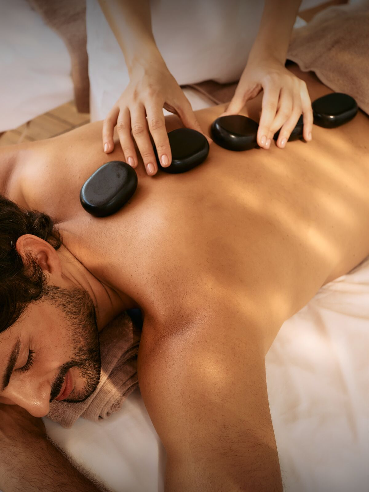
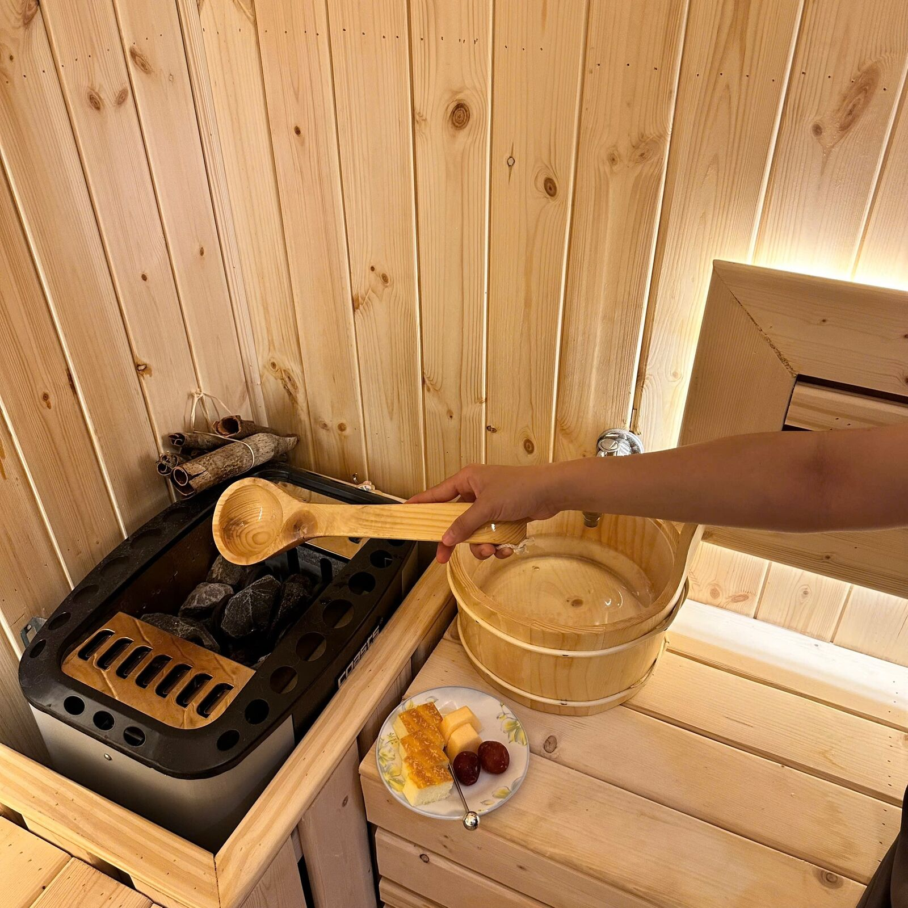

Massage xong thấy người nhẹ hẳn, ngủ ngon hơn, ai cũng muốn đi thường xuyên. Nhưng đi bao nhiêu là đủ, bao nhiêu là quá? Đi dày có tốt hơn không? Câu trả lời phụ thuộc vào **mục đích**, **loại massage** và **cơ thể** của chính bạn. Bài viết này giúp bạn tìm ra nhịp phù hợp, để massage trở thành thói quen chăm sóc sức khỏe lâu dài chứ không chỉ là "liều thuốc chữa cháy" khi quá mệt.

## Tần suất gợi ý theo nhu cầu

| Mục đích | Tần suất gợi ý | Gói phù hợp tại Mandala |
|---|---|---|
| **Thư giãn, giảm căng thẳng** | 2–4 tuần/lần | Massage Body, Liệu Pháp Bằng Hương Thơm |
| **Đau mỏi do ngồi văn phòng** | 1 lần/tuần trong 3–4 tuần đầu, sau đó 2–3 tuần/lần | Vai Gáy Chuyên Sâu, Body Chuyên Sâu |
| **Chơi thể thao, vận động nhiều** | Sau các buổi tập nặng hoặc 1–2 tuần/lần | Body Chuyên Sâu |
| **Cơ thể hay lạnh, nhiễm lạnh** | 2 tuần/lần, nhất là mùa mưa | Massage Đá Nóng, Cung phẩm Ngự Y |
| **Lao động chân tay, lái xe đường dài** | 1–2 tuần/lần | Body Chuyên Sâu, Massage Foot |

*Đây là gợi ý chung. Kỹ thuật viên sẽ tư vấn cụ thể hơn sau khi biết tình trạng và phản ứng của cơ thể bạn sau buổi đầu tiên.*

## Vì sao giai đoạn đầu nên đi dày hơn?

Với người đau mỏi lâu ngày, cơ bắp đã quen trạng thái co cứng. Một buổi massage giúp cơ thả lỏng, nhưng sau vài ngày, nếu thói quen sinh hoạt không đổi, cơ lại co dần. Đi **mỗi tuần một lần trong 3–4 tuần đầu** giúp cơ có thời gian "nhớ" trạng thái thả lỏng. Sau đó, bạn có thể giãn ra 2–3 tuần một lần để duy trì.

## Massage lực mạnh cần giãn cách hơn

Với **massage chuyên sâu** (lực mạnh, tác động sâu vào cơ), cơ thể cần thời gian hồi phục, giống như sau một buổi tập thể dục nặng. Nếu vùng cơ vẫn còn ê sau buổi trước, hãy chờ hết ê rồi mới làm tiếp. Thường khoảng cách hợp lý là **5–7 ngày**.

Với **massage thư giãn** lực nhẹ như massage tinh dầu, hương thơm, bạn có thể đi dày hơn mà không lo cơ bị quá tải.

## Dấu hiệu bạn đang massage quá dày

Massage tốt cho cơ thể, nhưng "quá" cũng không tốt. Hãy để ý các dấu hiệu sau:

- Cơ **ê ẩm kéo dài** nhiều ngày sau mỗi buổi
- Xuất hiện **vết bầm** dù lực không quá mạnh
- Cảm thấy **mệt mỏi** hơn thay vì nhẹ nhõm
- Phải **tăng lực tay liên tục** mới thấy "đã"
- Da vùng massage bị **kích ứng**, nổi mẩn với tinh dầu

Gặp những dấu hiệu này, hãy giãn khoảng cách, chọn liệu trình nhẹ hơn và báo kỹ thuật viên để điều chỉnh lực.

## Thời điểm nào trong ngày tốt nhất để massage?

- **Buổi tối (18:00 – 21:00):** tốt cho người muốn ngủ ngon. Massage xong về nhà nghỉ ngơi luôn. Mandala mở cửa đến 22:00.
- **Buổi trưa:** hợp với massage vai gáy ngắn, giúp tỉnh táo cho buổi chiều.
- **Sau khi tập thể dục:** đợi khoảng 1–2 tiếng để cơ thể ổn định nhịp tim, rồi mới massage.
- **Tránh** massage ngay sau bữa ăn lớn.

## Massage hiệu quả hơn khi kết hợp thói quen tốt

Massage giúp cơ thể thả lỏng, nhưng nếu nguyên nhân gây mỏi vẫn còn, cảm giác căng cứng sẽ quay lại. Hãy kết hợp:

1. **Ngồi đúng tư thế:** màn hình ngang tầm mắt, lưng tựa ghế, hai chân chạm sàn.
2. **Đứng dậy vận động** mỗi 30–45 phút.
3. **Giãn cơ nhẹ** buổi sáng và tối, 5–10 phút.
4. **Uống đủ nước**, ngủ đủ giấc.
5. **Chườm ấm** vai gáy những ngày mỏi nhiều.
6. **Xông hơi hoặc ngâm thảo dược** định kỳ để làm ấm cơ thể.

Xem thêm: [Đau mỏi cổ vai gáy ở dân văn phòng: nguyên nhân và cách chăm sóc](/blog/dau-moi-co-vai-gay-dan-van-phong/).

## Lên "lịch chăm sóc" cho bản thân

Một cách đơn giản để duy trì thói quen là **xen kẽ các liệu trình**, vừa đỡ nhàm chán, vừa chăm sóc toàn diện:

- **Tuần 1:** Massage Body hoặc Đá Nóng
- **Tuần 2:** Gội Đầu Dưỡng Sinh
- **Tuần 3:** Vai Gáy Chuyên Sâu
- **Tuần 4:** Nghỉ hoặc ngâm chân thảo dược tại nhà

Với ngân sách hợp lý, bạn có thể chăm sóc bản thân đều đặn mỗi tháng.

## Ai cần hỏi bác sĩ trước khi massage thường xuyên?

- Phụ nữ mang thai
- Người có bệnh tim mạch, huyết áp chưa ổn định, tiểu đường
- Người có giãn tĩnh mạch, rối loạn đông máu, đang dùng thuốc chống đông
- Người mới chấn thương, phẫu thuật
- Người có bệnh ngoài da ở vùng cần massage

## Kết hợp massage với thói quen tại nhà

Massage giúp cơ thả lỏng, nhưng hiệu quả sẽ giữ được lâu hơn nếu bạn chăm sóc cơ thể giữa các buổi:

- **Đứng dậy vận động** 5 phút sau mỗi giờ ngồi làm việc.
- **Giãn cơ cổ, vai, lưng** nhẹ nhàng vào buổi sáng và trước khi ngủ.
- **Điều chỉnh tư thế ngồi**: màn hình ngang tầm mắt, lưng tựa ghế, hai chân chạm sàn.
- **Uống đủ nước** và ngủ đủ giấc để cơ phục hồi.
- **Đi bộ hoặc bơi** vài buổi mỗi tuần.

Khi kết hợp những thói quen này, nhiều người thấy có thể giãn khoảng cách giữa các buổi massage mà cơ thể vẫn nhẹ nhõm.

Ngoài ra, hãy chú ý những tín hiệu cho thấy bạn nên đi massage sớm hơn dự định: thức dậy thấy cứng cổ, vai nặng như đeo đá, khó xoay đầu, ngủ không sâu, hoặc đau đầu vào cuối ngày làm việc.

## Câu hỏi thường gặp

**Massage mỗi ngày có được không?**
Massage thư giãn nhẹ thì không sao, nhưng với đa số người, không cần thiết. 1–2 lần/tuần là đủ.

**Bao lâu sau massage thì thấy hiệu quả?**
Cảm giác nhẹ nhõm có ngay sau buổi đầu. Với đau mỏi lâu ngày, thường cần vài buổi liên tiếp.

## Duy trì thói quen massage tại Mandala

Mandala có các liệu trình massage từ **249.000đ**, phòng riêng tư và phòng đôi, mở cửa 10:00 – 22:00 tại 86 Hàn Mặc Tử, Buôn Ma Thuột.

[Xem các liệu trình massage trị liệu](/dich-vu/massage-tri-lieu/) · [Đặt lịch online](/lien-he/#dat-lich) · Gọi/Zalo **0395 546 979**

*Bài viết mang tính tham khảo, không thay thế tư vấn y khoa.*
