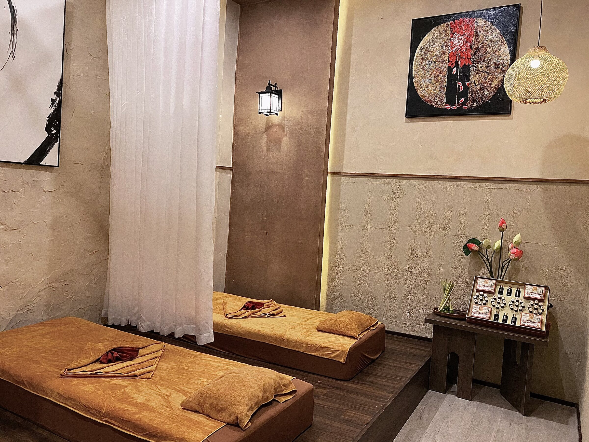
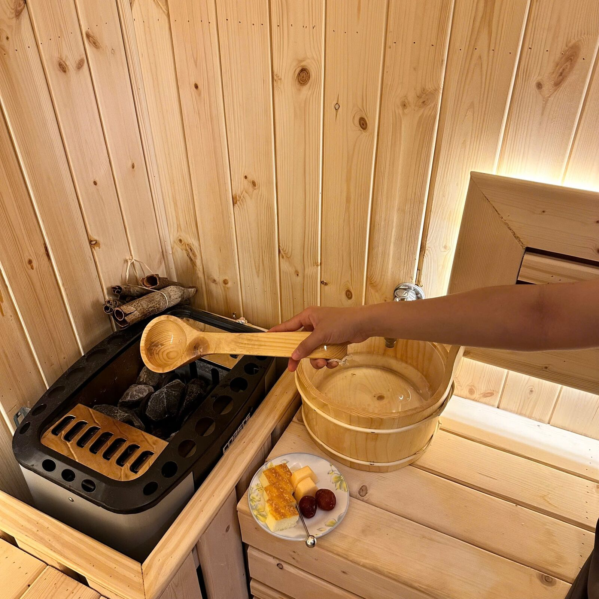
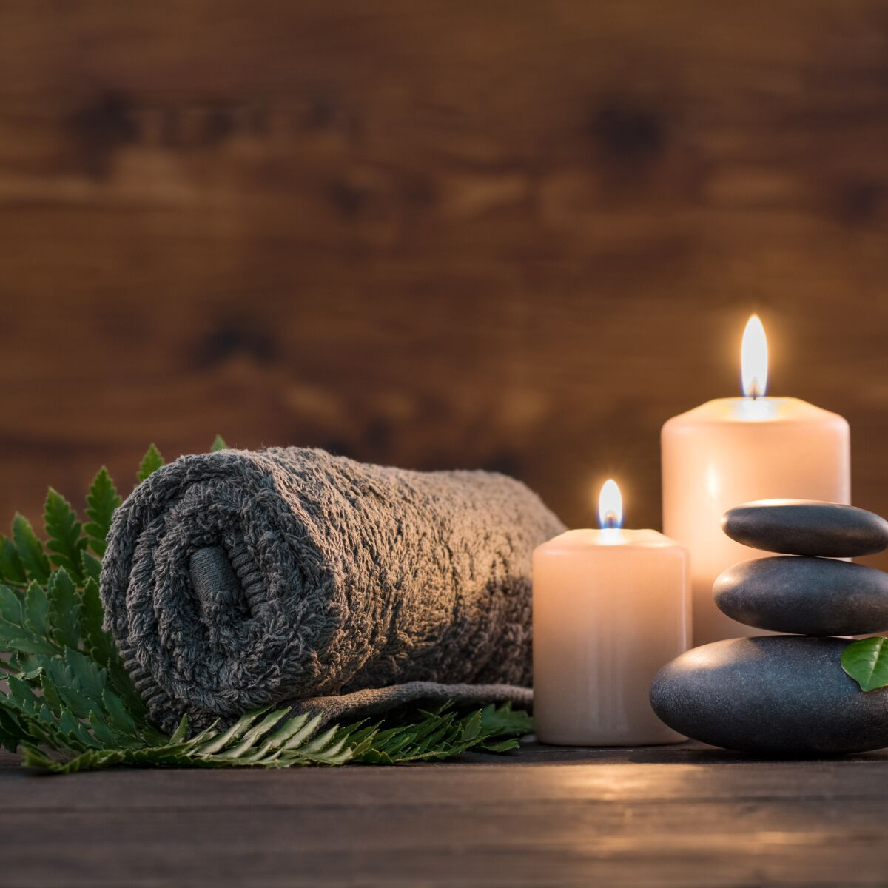

Một buổi hẹn hò không nhất thiết phải là nhà hàng hay rạp phim. Ngày càng nhiều cặp đôi ở Buôn Ma Thuột chọn **massage cặp đôi**: cùng nhau thư giãn, tạm rời xa điện thoại và có một khoảng thời gian thật sự dành cho nhau. Bài viết này giới thiệu trải nghiệm phòng đôi tại Mandala, gợi ý liệu trình theo từng dịp và vài kinh nghiệm để buổi hẹn trọn vẹn hơn.

## Massage cặp đôi là gì?

Hai người được massage **cùng lúc, trong cùng một phòng riêng**, mỗi người một kỹ thuật viên. Mỗi người có thể chọn liệu trình và lực tay khác nhau: một người thích nhẹ nhàng với tinh dầu, người kia muốn chuyên sâu vai gáy, hoàn toàn được.

Massage cặp đôi không chỉ dành cho người yêu hay vợ chồng. Rất nhiều khách của Mandala đặt phòng đôi cho **mẹ và con gái, hai chị em, bạn thân, đồng nghiệp**, hoặc bạn bè đi du lịch cùng nhau.

## Phòng đôi tại Mandala có gì?

- Phòng riêng tư, **nệm sàn**, rèm trắng, đèn tre và tranh sơn mài mang hơi thở Á Đông
- Ánh sáng dịu, hương thảo mộc nhẹ
- Khăn, ga **thay mới cho từng khách**
- Trà gừng ấm đón tiếp và trà thảo mộc sau liệu trình
- Đủ chỗ cho hai người thay đồ, nghỉ ngơi thoải mái

## Gợi ý liệu trình cho hai người

| Nếu hai bạn… | Gợi ý | Giá |
|---|---|---|
| Muốn thư giãn nhẹ nhàng | **Massage Body** | 249.000đ/người |
| Thích cảm giác ấm áp | **Massage Body Đá Nóng** | 349.000đ/người |
| Muốn trải nghiệm trọn vẹn | **Combo Liệu Pháp Thư Giãn Cơ Thể** | 799.000đ |
| Dịp đặc biệt | **Combo Liệu Pháp Tăng Cường Tinh Thần** | 999.000đ |
| Một người thích massage, một người thích gội đầu | Đặt chung khung giờ, mỗi người một liệu trình | Theo gói |
| Hay đau mỏi vì công việc | **Vai Gáy Chuyên Sâu** hoặc **Cung phẩm Ngự Y** | từ 299.000đ/người |

*Nhắn Zalo để được tư vấn chi tiết các bước trong combo.*

## Thêm trải nghiệm: xông hơi và ngâm thảo dược

Để buổi hẹn thêm trọn vẹn, nhiều cặp đôi kết hợp massage với **xông hơi khô** hoặc **ngâm bồn gỗ thảo dược**. Hơi ấm giúp cơ thể thả lỏng trước khi massage, còn bồn ngâm thảo dược với gừng, quế, sả mang lại cảm giác ấm áp, thư thái. Hãy hỏi lễ tân Mandala về các liệu trình có bước xông hơi, ngâm bồn.

## Dịp nào phù hợp?

- **Kỷ niệm ngày yêu, ngày cưới**
- **Sinh nhật** của người ấy
- **Valentine 14/2, 8/3, 20/10**
- **Sau một chuyến đi xa**, cùng nhau xả mệt
- **Trước ngày cưới**, giúp cô dâu chú rể thư giãn
- **Cảm ơn bố mẹ**, đưa mẹ hoặc bố đi spa cùng mình
- **Đơn giản là cuối tuần**, muốn dành thời gian cho nhau

## Kinh nghiệm đặt massage cặp đôi

1. **Đặt trước ít nhất 1 ngày.** Số phòng đôi có hạn, nhất là tối thứ Sáu, thứ Bảy và các ngày lễ.
2. **Báo rõ "phòng đôi"** khi đặt lịch, kèm liệu trình của từng người.
3. **Báo trước mong muốn riêng:** kỹ thuật viên nam hay nữ, vùng cần chú ý, lực tay.
4. **Đến sớm 10 phút** để thay đồ, thưởng thức trà mà không vội.
5. **Tắt chuông điện thoại** để thật sự dành thời gian cho nhau.
6. Muốn **gây bất ngờ**? Nhắn Mandala trước để được hỗ trợ.

## Sau khi massage: kéo dài buổi hẹn

Buôn Ma Thuột có nhiều lựa chọn để tiếp tục buổi tối sau massage: một bữa tối nhẹ, một quán cà phê sân vườn yên tĩnh (nên chọn đồ uống ít caffeine nếu muốn ngủ ngon), hoặc đơn giản là về nhà nghỉ ngơi sớm. Cơ thể vừa được thư giãn, đây là lúc tuyệt vời để trò chuyện chậm rãi với nhau.

## Làm quà tặng

Không cùng đi được? Mandala có **thẻ quà tặng** để bạn tặng người thân, người yêu một buổi thư giãn. Đây là món quà ý nghĩa dịp sinh nhật, kỷ niệm, 8/3, 20/10 hay Tết, nhất là với những người bận rộn, ít khi dành thời gian chăm sóc bản thân. Nhắn Zalo **0395 546 979** để được tư vấn chọn liệu trình hoặc combo phù hợp cho thẻ quà tặng. Xem thêm tại [bảng giá](/bang-gia/).

## Gợi ý lịch trình một buổi hẹn hò thư giãn

Một buổi tối thong thả cho hai người ở Buôn Ma Thuột có thể như sau:

1. **Chiều muộn:** đến Mandala, thưởng thức trà thảo mộc ở sảnh chờ, trò chuyện cùng lễ tân để chọn liệu trình.
2. **Liệu trình trong phòng đôi:** massage body hoặc đá nóng, sau đó gội đầu dưỡng sinh để thư giãn trọn vẹn.
3. **Nghỉ ngơi vài phút** với trà ấm trước khi ra về.
4. **Bữa tối nhẹ nhàng** ở một quán quen trong thành phố, rồi về nghỉ sớm.

Lịch trình này phù hợp cho kỷ niệm ngày cưới, sinh nhật, hay đơn giản là một buổi "hẹn hò lại" sau những tuần bận rộn.

## Không chỉ cho vợ chồng

Phòng đôi cũng rất hợp với **mẹ và con gái, chị em, bạn thân**. Nhiều khách đưa bố mẹ đi massage như một món quà nhỏ để cảm ơn, hoặc rủ bạn thân đi "xả stress" sau đợt làm việc căng thẳng. Hai người cùng thư giãn trong một không gian riêng, có thể trò chuyện nhỏ nhẹ hoặc cùng im lặng nghỉ ngơi.

## Lưu ý

- Báo trước nếu một trong hai người đang mang thai, có bệnh lý nền hoặc chấn thương.
- Không nên massage ngay sau bữa ăn lớn hoặc khi đã uống rượu bia.
- Massage là liệu pháp thư giãn, không thay thế điều trị y khoa.

Lần đầu đi massage? Đọc thêm [Lần đầu đi massage: nên chọn loại nào, cần chuẩn bị gì?](/blog/lan-dau-di-massage/)

## Chuẩn bị gì trước khi đến?

Hai bạn nên ăn nhẹ trước khoảng một tiếng, mặc trang phục thoải mái và đến sớm 10 phút để thay đồ, uống trà. Nếu mỗi người thích một lực tay khác nhau, cứ nói với kỹ thuật viên của mình; liệu trình trong phòng đôi vẫn được điều chỉnh riêng cho từng người. Nếu muốn làm bất ngờ cho người ấy, hãy nhắn trước để Mandala chuẩn bị chu đáo hơn.

## Đặt phòng đôi tại Mandala

📍 86 Hàn Mặc Tử, Phường Buôn Ma Thuột, Đắk Lắk · 🕙 10:00 – 22:00 hằng ngày · ☎ **0395 546 979** (Zalo)

[Đặt lịch online](/lien-he/#dat-lich) · [Xem bảng giá](/bang-gia/) · [Các liệu trình massage](/dich-vu/massage-tri-lieu/)
