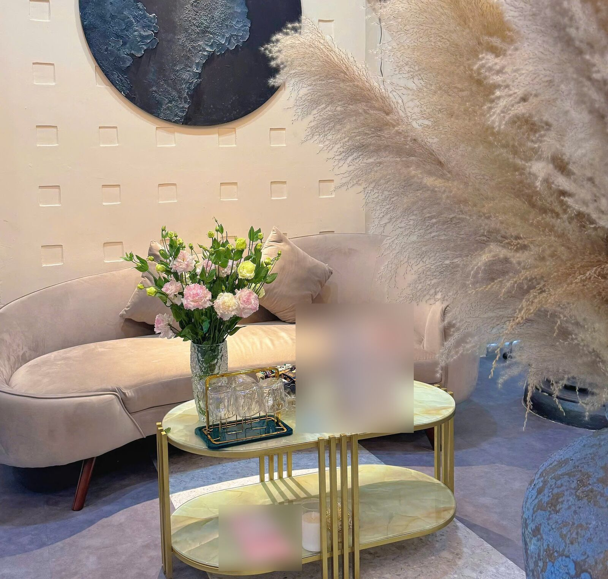
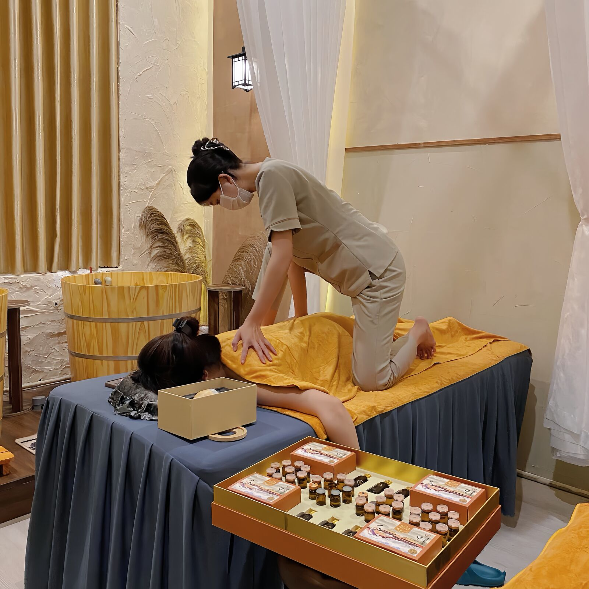

Nhiều khách quen của Mandala không ở trung tâm Buôn Ma Thuột mà đến từ các vùng lân cận như **Krông Pắc (Phước An), Cư M'gar, Buôn Đôn, Krông Ana, Cư Kuin, Ea Kar…** Thường là kết hợp: lên thành phố khám bệnh, mua sắm, làm giấy tờ, đưa con đi học hay thăm người thân, rồi dành thêm một buổi để thư giãn trước khi về. Bài viết này gợi ý cách sắp xếp để chuyến lên phố vừa xong việc vừa được nghỉ ngơi.

*Lưu ý: từ tháng 7/2025, đơn vị hành chính ở Đắk Lắk đã được sắp xếp lại theo mô hình chính quyền hai cấp. Bài viết dùng tên khu vực quen thuộc để bạn dễ hình dung.*

## Vì sao nhiều khách vùng lân cận chọn ghé Buôn Ma Thuột?

- **Tiện đường.** Đã lên thành phố làm việc, ghé thêm 1–2 tiếng để thư giãn trước khi về.
- **Nhiều lựa chọn liệu trình.** Từ gội đầu dưỡng sinh nhanh đến trị liệu chuyên sâu, ngâm thảo dược, xông hơi.
- **Đi cùng gia đình.** Có phòng đôi cho vợ chồng, mẹ con, chị em.
- **Thư giãn sau những ngày làm việc nặng.** Đặc biệt với người làm vườn cà phê, sầu riêng, hồ tiêu.

## Mandala ở đâu?

📍 **86 Hàn Mặc Tử, Phường Buôn Ma Thuột, Đắk Lắk**, khu vực trung tâm, dễ tìm, **có chỗ đậu ô tô và xe máy**.

Mở **[Google Maps chỉ đường đến Mandala](https://www.google.com/maps/place/Mandala+-+Healthcare+%26+Spa/data=!4m2!3m1!1s0x0:0x96ce09a711ea051c)**, chọn điểm xuất phát của bạn để xem quãng đường và thời gian di chuyển chính xác nhất theo tình hình giao thông thực tế.

## Gợi ý gói theo thời gian bạn có

| Bạn có… | Gợi ý | Giá |
|---|---|---|
| Khoảng 1 tiếng giữa các việc | **Gội Đầu Dưỡng Sinh** | 159.000đ |
| Một buổi chiều thong thả | **Massage Body Đá Nóng** hoặc **Gội Đầu Trung Hoa** | 349.000đ / 239.000đ |
| Hay đau mỏi vai lưng do làm vườn, lái xe | **Body Chuyên Sâu** hoặc **Massage Cổ – Vai – Gáy (Ngự Y)** | 399.000đ / 499.000đ |
| Đi cùng người thân | **Phòng đôi** + combo | từ 799.000đ |
| Chân mỏi vì đi lại nhiều | **Massage Foot** | Liên hệ |

## Dành cho người làm vườn, làm rẫy, lái xe đường dài

Công việc nhà nông và lái xe ở Tây Nguyên thường khiến **lưng, vai, cánh tay, bắp chân** mỏi nhiều: cúi người hái cà phê, gánh vác, vác bao, ngồi xe hàng giờ. Mùa thu hoạch, cơ thể càng mệt hơn. Các liệu trình phù hợp:

- **Body Chuyên Sâu (399.000đ):** lực tay mạnh, tác động sâu vào các nhóm cơ mỏi.
- **Cung phẩm Ngự Y:** thảo dược ấm, lăn ống đồng, phù hợp người đau mỏi lâu ngày, cơ thể nhiễm lạnh vì làm việc ngoài trời mưa gió. Đọc thêm: [Lăn ống đồng thảo dược là gì?](/blog/lan-ong-dong-thao-duoc-la-gi/)
- **Ngâm thảo dược:** làm ấm cơ thể, thư giãn bắp chân, bàn chân.

## Dành cho người lên phố khám bệnh, chăm người thân

Những chuyến lên Buôn Ma Thuột để khám bệnh hay chăm người nhà ở bệnh viện thường rất mệt: chờ đợi lâu, ngủ không đủ, lo lắng. Một buổi **gội đầu dưỡng sinh** giúp đầu óc nhẹ nhõm, vai gáy bớt căng. Tuy nhiên, nếu bản thân bạn đang điều trị bệnh, hãy hỏi ý kiến bác sĩ trước khi massage, và báo cho kỹ thuật viên tình trạng sức khỏe của mình.

## Dành cho gia đình đưa con lên phố

Bố mẹ đưa con đi học thêm, thi cử hay khám bệnh có thể tranh thủ khoảng thời gian chờ để **gội đầu, massage vai gáy**. Hãy báo lịch của bạn khi đặt chỗ, Mandala sẽ sắp xếp khung giờ phù hợp.

## Lên phố mùa nào thì nên thư giãn?

- **Mùa thu hoạch cà phê** (khoảng cuối năm): làm việc liên tục, lưng vai mỏi nhiều, rất cần một buổi trị liệu sau khi xong việc.
- **Mùa mưa:** trời ẩm lạnh, cơ thể dễ mỏi, ngâm thảo dược và lăn ống đồng giúp làm ấm.
- **Mùa khô, nắng gió:** da và tóc khô, gội đầu dưỡng sinh và chăm sóc da giúp bạn dễ chịu hơn.
- **Dịp lễ, Tết:** nhiều người lên phố mua sắm, đây cũng là lúc spa đông khách, nên đặt lịch sớm.

## Đi nhóm, đi cùng gia đình

Nếu bạn đi cùng người thân hoặc một nhóm bạn, hãy báo số người và giờ dự kiến khi đặt lịch để Mandala sắp xếp phòng đôi hoặc các phòng gần nhau. Đi nhóm giúp chuyến lên phố vui hơn, mọi người cùng thư giãn rồi cùng về.

## Mẹo cho chuyến đi

1. **Gọi/Zalo đặt lịch trước.** Báo giờ bạn đến thành phố, Mandala giữ phòng sẵn, không phải chờ.
2. **Chọn khung giờ hợp lý** để không phải vội về. Mandala mở cửa đến **22:00**, nhưng nếu về xa, nên chọn buổi chiều để kịp về trước khi tối hẳn.
3. **Nếu về bằng xe máy buổi tối sau gội đầu:** sấy tóc thật khô, mặc áo khoác, đội mũ kín để không bị lạnh.
4. **Ăn nhẹ trước khi đến**, không nên massage khi quá no hoặc quá đói.
5. **Mang theo đồ thoải mái** nếu bạn định ngâm thảo dược, xông hơi.
6. **Không nên lái xe đường dài ngay** sau liệu trình quá thư giãn nếu bạn thấy buồn ngủ. Nghỉ thêm vài phút với trà ấm.

## Sau buổi thư giãn, về nhà nên làm gì?

Uống thêm nước ấm, ăn bữa tối nhẹ và đi ngủ sớm hơn thường lệ một chút. Tránh làm việc nặng ngay tối hôm đó để cơ thể giữ được cảm giác thả lỏng. Nhiều khách chia sẻ rằng đêm sau buổi massage là đêm họ ngủ sâu nhất trong tuần.

**Mandala có chỗ đậu ô tô và xe máy**, nên bạn đi xe riêng lên phố cũng không phải lo tìm chỗ gửi xe. Nếu lần đầu ghé, cứ gọi điện trước để được hướng dẫn đường đi cho thuận tiện.

## Lưu ý sức khỏe

Báo trước cho kỹ thuật viên nếu bạn đang mang thai, có bệnh tim mạch, huyết áp, tiểu đường, giãn tĩnh mạch, chấn thương gần đây hoặc bệnh ngoài da. Các liệu trình tại Mandala là liệu pháp thư giãn, hỗ trợ sức khỏe, **không thay thế** điều trị y khoa.

## Đặt lịch

☎ **0395 546 979** (Zalo) · 🕙 10:00 – 22:00 hằng ngày · 📍 86 Hàn Mặc Tử, Phường Buôn Ma Thuột, Đắk Lắk

[Đặt lịch online](/lien-he/#dat-lich) · [Xem bảng giá đầy đủ](/bang-gia/) · [Kinh nghiệm chọn spa uy tín](/blog/kinh-nghiem-chon-spa-buon-ma-thuot/)
