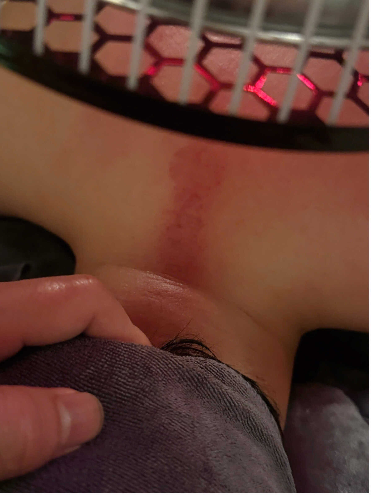
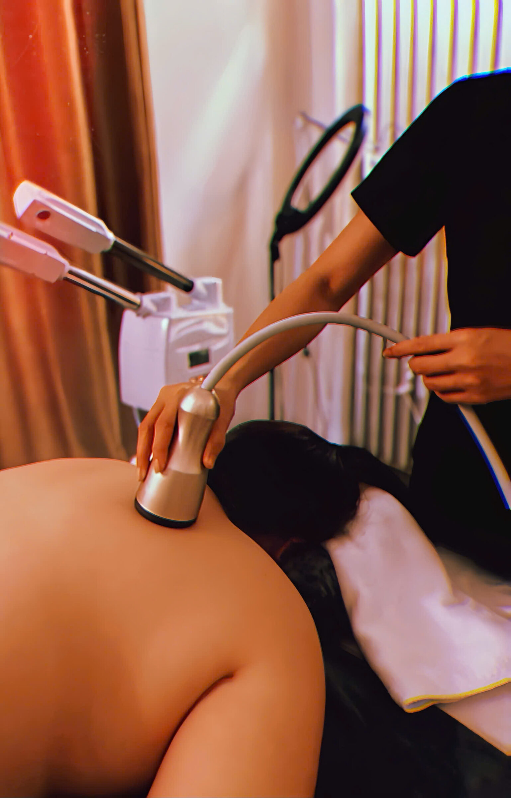

Sau một tuần ngồi máy tính, vai gáy cứng như đá, lưng nặng trĩu, sáng dậy xoay cổ cũng thấy khó… Nhiều người lúc ấy lại nhớ đến cách bà, mẹ vẫn làm: **cạo gió**. Ngày nay, cạo gió và **giác hơi** được thực hiện bài bản hơn trong spa dưỡng sinh, kết hợp tinh dầu ấm và đèn hồng ngoại để cơ thể thả lỏng sâu.

Bài viết giúp bạn hiểu những vấn đề cổ vai gáy thường gặp, các kỹ thuật trị liệu chuyên sâu như cạo gió – giác hơi, vết đỏ sau khi làm có đáng lo không, và ai nên – ai không nên thử.

## Những vấn đề cổ vai gáy thường gặp

- **Đau cổ vai gáy mạn tính:** mỏi, cứng kéo dài nhiều tuần, đỡ rồi lại tái lại, thường do ngồi lâu và căng thẳng.
- **Hội chứng "cổ rùa":** đầu đưa ra trước so với vai do cúi nhìn màn hình, điện thoại lâu ngày. Cơ cổ và vai trên phải gồng liên tục để giữ đầu nên rất dễ mỏi.
- **"U đại chùy":** phần gồ lên ở vùng chân cổ – đầu lưng (quanh đốt sống cổ thứ 7), thường đi kèm tư thế cổ rùa, vai tròn, khiến vùng này cứng và nặng.
- **Nhức mỏi bả vai, tê tay:** cảm giác nặng, nhức lan xuống bả vai; đôi khi tê bì cánh tay.
- **Thoái hóa đốt sống cổ:** thường gặp ở người lớn tuổi hoặc ngồi sai tư thế nhiều năm.

Với các tình trạng do **co cứng cơ và tư thế**, trị liệu chuyên sâu có thể giúp vùng cổ vai được giải phóng căng cứng, vận động dễ chịu hơn. Riêng **tê tay, yếu tay** hoặc **thoái hóa đốt sống cổ** đã được chẩn đoán, bạn nên khám và hỏi ý kiến bác sĩ trước, rồi báo cho kỹ thuật viên để liệu trình được điều chỉnh phù hợp.

## Kỹ thuật 1: Cạo gió

Cạo gió (tiếng Trung gọi là *gua sha*) là phương pháp dân gian của y học cổ truyền phương Đông. Kỹ thuật viên thoa dầu lên da, rồi dùng dụng cụ có cạnh tròn nhẵn – sừng, đá, đồng – miết dọc theo vùng cổ, vai, lưng theo một chiều.

Theo quan niệm Đông y, cạo gió giúp "thông kinh lạc", đưa khí huyết lưu thông ở vùng đang bị ứ trệ. Theo cách nhìn hiện đại, động tác miết làm tăng tuần hoàn máu tại chỗ và giúp các nhóm cơ co cứng được thả lỏng.

## Vết đỏ sau khi cạo gió là gì? Có nguy hiểm không?

Đây là câu hỏi nhiều người lo nhất khi lần đầu thấy lưng mình đỏ sậm thành từng vệt.

Những vết đỏ, tím li ti đó (dân gian gọi là "gió" hay "sa") là các **mao mạch nhỏ dưới da bị vỡ** khi da được miết nhiều lần – về mặt y khoa gọi là *xuất huyết dạng chấm*. Đây là phản ứng mong đợi của liệu pháp, không phải vết thương hở:

- Vết đỏ thường **mờ dần sau vài ngày**, tùy cơ địa.
- Vết đậm hay nhạt khác nhau ở mỗi người và mỗi vùng, không nhất thiết nói lên bạn "nhiều gió" hay "bệnh nặng".
- Khi làm đúng cách, cạo gió **không nên gây đau**. Kỹ thuật viên chỉ tăng lực dần theo mức bạn thấy dễ chịu.

Vì vậy, nếu bạn sắp đi bơi, mặc áo hở lưng hay có sự kiện quan trọng, hãy cân nhắc thời điểm làm.

## Kỹ thuật 2: Giác hơi

Giác hơi là liệu pháp dùng các **cốc tạo lực hút** đặt lên da. Lực hút kéo nhẹ da và lớp mô bên dưới lên, giúp vùng cơ được giãn ra và máu lưu thông tại chỗ. Giác hơi cũng để lại các vết tròn ửng đỏ, mờ dần sau vài ngày, tương tự cạo gió.

Ngày nay, bên cạnh cốc thủy tinh dùng lửa truyền thống, nhiều nơi dùng **máy giác hơi điện**: kiểm soát được lực hút, có chế độ làm ấm và đèn – an toàn và dễ điều chỉnh hơn, không dùng lửa trực tiếp.

## Kỹ thuật 3: Đèn hồng ngoại

Sau khi cạo gió hoặc giác hơi, kỹ thuật viên thường chiếu **đèn hồng ngoại** lên vùng vai lưng trong vài phút. Hơi ấm từ đèn giúp cơ tiếp tục thả lỏng, cơ thể ấm áp và dễ chịu hơn – đặc biệt trong những ngày se lạnh của Tây Nguyên.

## Cạo gió, giác hơi có tác dụng gì?

Nhiều người tìm đến cạo gió, giác hơi khi:

1. **Đau mỏi, căng cứng cổ – vai – gáy** do ngồi lâu, sai tư thế.
2. **Mỏi lưng** sau ngày dài làm việc hoặc lái xe.
3. **Cảm thấy nặng người, mệt mỏi**, muốn cơ thể nhẹ nhõm hơn.
4. **Cơ thể nhiễm lạnh**, tay chân lạnh, muốn được làm ấm.

Một số nghiên cứu nhỏ cho thấy cạo gió có thể giúp giảm đau cổ mạn tính trong ngắn hạn, nhưng các chuyên gia vẫn cho rằng cần thêm nhiều nghiên cứu lớn để khẳng định. Vì vậy, hãy xem cạo gió và giác hơi là **liệu pháp hỗ trợ thư giãn**, không phải phương pháp chữa bệnh.

## Ai không nên cạo gió, giác hơi?

Không thực hiện, hoặc cần hỏi ý kiến bác sĩ trước, nếu bạn:

- Đang **mang thai**
- Có **rối loạn đông máu**, đang dùng **thuốc chống đông**
- Có **bệnh ngoài da** ở vùng cần làm (chàm, vảy nến…), vết thương hở, da cháy nắng
- **Tiểu đường**, bệnh tim mạch, huyết áp chưa ổn định
- Đang **sốt cao**, quá mệt, quá đói hoặc vừa ăn quá no
- Vừa thực hiện thủ thuật thẩm mỹ ở vùng định làm

Nếu đau cổ vai kèm **tê tay, yếu tay, chóng mặt**, hoặc đau sau chấn thương – hãy đi khám bác sĩ trước.

## Quy trình trị liệu cổ vai gáy chuyên sâu

Mỗi liệu trình được **cá nhân hóa theo tình trạng** của từng người, thay vì làm giống nhau cho tất cả.

1. **Kiểm tra và tư vấn:** quan sát tư thế cổ vai, hỏi vùng đau mỏi, thời gian đau, tiền sử sức khỏe; loại trừ các trường hợp không phù hợp.
2. **Làm nóng cơ:** massage nhẹ với tinh dầu ấm vùng cổ vai lưng.
3. **Cạo gió:** dụng cụ được vệ sinh sạch, miết một chiều với lực vừa phải.
4. **Giác hơi** (nếu phù hợp): đặt cốc tại các điểm co cứng.
5. **Chiếu đèn hồng ngoại** để làm ấm và thả lỏng.
6. **Nghỉ ngơi**, uống trà gừng ấm.

## Chăm sóc sau khi cạo gió, giác hơi

- **Giữ ấm** vùng vai lưng, tránh gió lạnh và điều hòa thổi trực tiếp.
- **Không tắm nước lạnh** ngay; nên đợi vài giờ và tắm nước ấm.
- **Uống nước ấm**, trà gừng.
- **Nghỉ ngơi**, tránh vận động mạnh ngay sau đó.
- Không cạo lại khi vết cũ chưa mờ hẳn.

## Bao lâu nên cạo gió một lần?

Không nên làm quá dày. Thông thường nên để vết cũ mờ hết rồi mới làm lại, tùy cơ địa và tư vấn của kỹ thuật viên. Nếu thường xuyên đau mỏi, hãy kết hợp với điều chỉnh tư thế ngồi và vận động nhẹ mỗi ngày.

## Trị liệu cổ vai gáy chuyên sâu tại Mandala Buôn Ma Thuột

Mandala – Healthcare & Spa, chốn an yên ngay giữa lòng Buôn Ma Thuột, tổ chức các đợt **trị liệu cổ vai gáy chuyên sâu cùng chuyên gia trị liệu**. Chuyên gia trực tiếp kiểm tra tình trạng và thực hiện liệu trình riêng cho từng khách, hướng đến giải phóng căng cứng, cải thiện vận động và giúp cơ thể tìm lại sự nhẹ nhàng, cân bằng vốn có.

Số lịch hẹn mỗi đợt có giới hạn. Hãy theo dõi [Facebook Mandala](https://www.facebook.com/mandalabmt) để cập nhật lịch đợt tiếp theo, hoặc gọi/Zalo **0395 546 979** để được tư vấn và đặt lịch sớm.

Nếu bạn đang đau mỏi lâu ngày, có thể tham khảo thêm liệu trình [Cung phẩm Ngự Y](/dich-vu/dong-y-duong-sinh/) với thảo dược và lăn ống đồng ấm.

*Bài viết mang tính tham khảo, không thay thế chẩn đoán và điều trị y khoa.*
